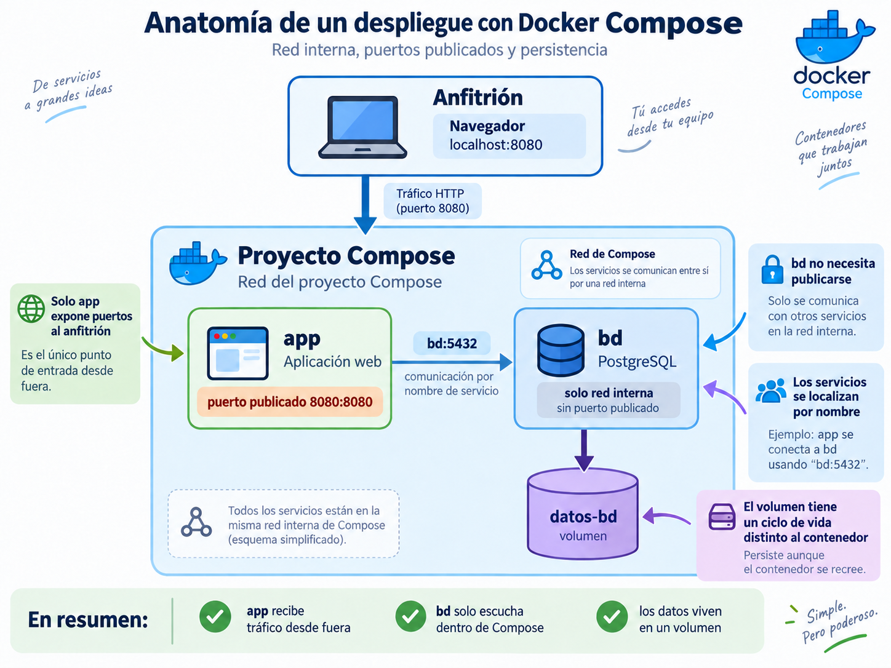
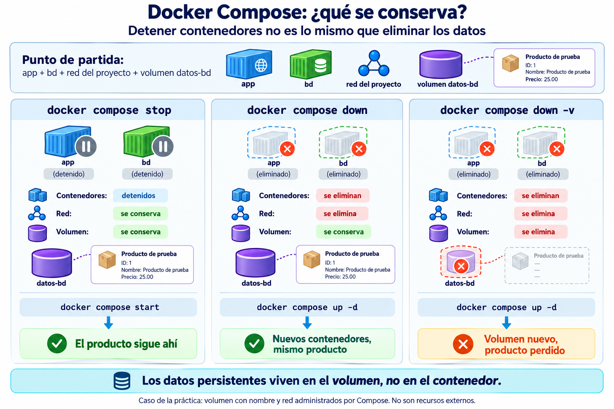
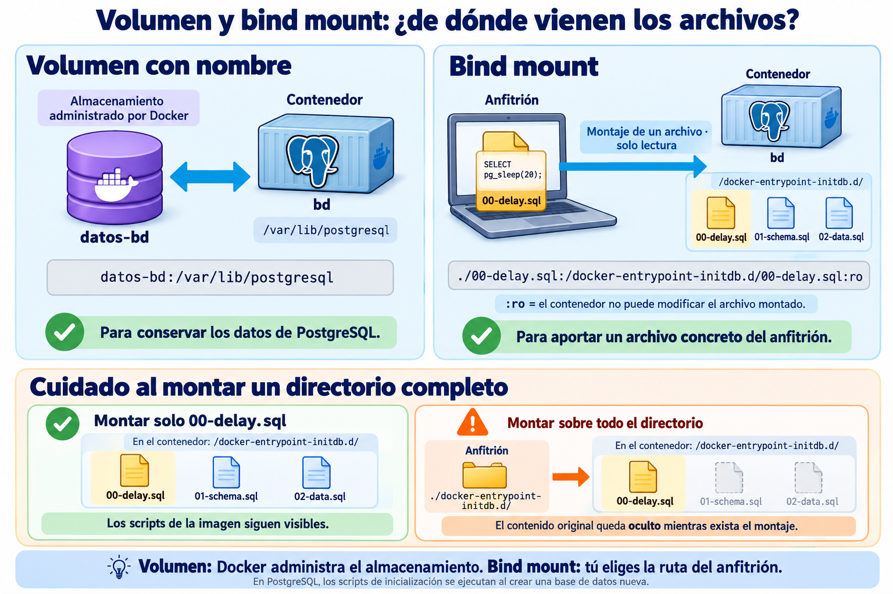
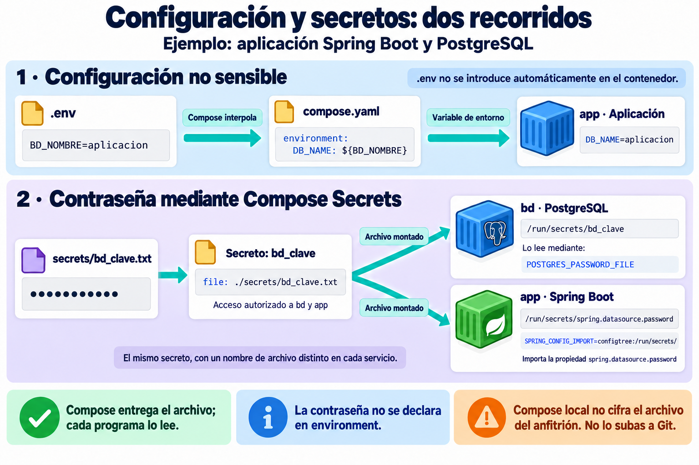
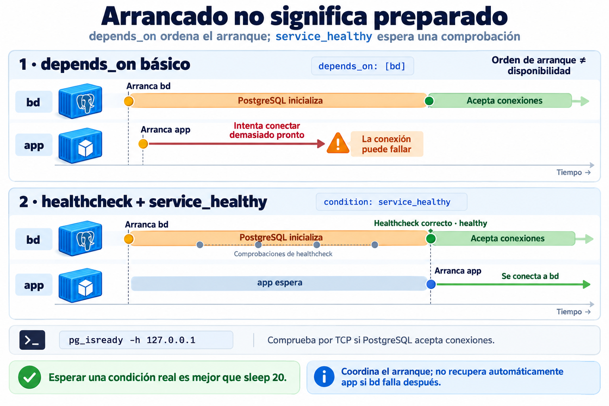
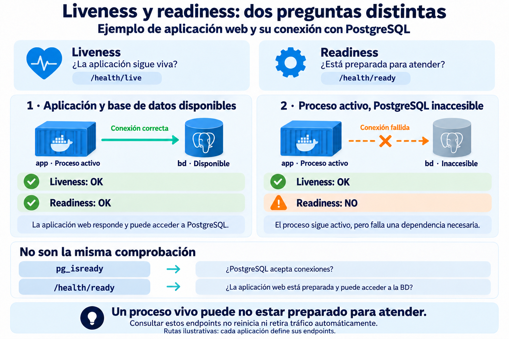

# 🧵 Docker Compose

!!! info "Descarga de diapositivas"
    [Descarga las diapositivas](diapositivas/docker-compose.pptx){target="_blank" rel="noopener"}

---

Desplegar una aplicación web con base de datos mediante contenedores sueltos requiere varios comandos: crear una red, arrancar PostgreSQL, pasar variables y poner en marcha la aplicación.

El problema ya no es saber hacerlo una vez. El problema es que **toda esa información también forma parte del despliegue**. Si solo existe en tu memoria o en el historial del terminal, otra persona tendrá que reconstruir el procedimiento.

Docker Compose permite trasladar esa descripción a un fichero versionado.

!!! abstract "Mapa de la sesión"
    **Declarar → conectar → persistir → configurar → esperar → operar**

    Trabajaremos con dos servicios, `app` y `bd`. El objetivo no es añadir más componentes, sino describir correctamente **cómo deben ejecutarse y relacionarse**.

---

## 🧾 1. De comandos a un estado declarado

Con contenedores sueltos, el procedimiento combina órdenes para crear una red, arrancar PostgreSQL, montar almacenamiento y configurar la aplicación. La arquitectura queda repartida entre esas órdenes.

Compose reúne esa descripción en `compose.yaml`. Este fragmento muestra únicamente los servicios y las imágenes; iremos añadiendo su configuración:

```yaml
services:
  bd:
    image: postgres:18-alpine
  app:
    image: mi-app:1.0.0
```

Con la configuración completa y sus archivos locales preparados, ejecutamos:

```bash
docker compose up -d
```

**`docker run` expresa una acción concreta; `compose.yaml` describe el estado que queremos obtener.** Compose interpreta esa declaración y crea o actualiza los recursos necesarios.

!!! note "Ejemplos progresivos"
    Los fragmentos siguientes explican partes del despliegue y no son configuraciones completas por separado. `mi-app:1.0.0` es un nombre ilustrativo: representa una imagen que tú has construido o publicado, no una imagen pública que pueda descargarse con ese nombre. Usaremos PostgreSQL como ejemplo de base de datos y una aplicación Spring Boot para ilustrar la lectura de secretos.

!!! warning "Sintaxis actual"
    En Compose moderno no necesitas añadir una clave superior `version:`. Además, utilizaremos `docker compose` como subcomando de Docker, no el antiguo ejecutable `docker-compose`.

---

## 🧩 2. Servicios, red y puertos

Un proyecto Compose se organiza alrededor de:

```yaml
services:
```

Cada entrada representa un **servicio**:

```yaml
services:
  app:
    image: mi-app:1.0.0

  bd:
    image: postgres:18-alpine
```

Los nombres `app` y `bd` identifican los servicios y también sirven para que se localicen dentro de la red del proyecto.

Las claves que utilizarás en esta sesión son:

| Clave | Qué describe |
|---|---|
| `image` | imagen que ejecuta el servicio |
| `ports` | puertos publicados hacia el anfitrión |
| `environment` | variables entregadas al contenedor |
| `secrets` | archivos sensibles autorizados para el servicio |
| `volumes` | almacenamiento o ficheros montados |
| `depends_on` | relación de arranque entre servicios |
| `healthcheck` | condición para evaluar el estado del servicio |

La arquitectura base de esta sesión puede resumirse así:



### 2.1. Lectura de la arquitectura

El navegador entra por `app` mediante el puerto publicado `8080:8080`. La aplicación localiza PostgreSQL por el nombre `bd:5432`, sin publicar el puerto de la base de datos. El volumen `datos-bd` conserva los datos al recrear los contenedores.

!!! note "Red del proyecto"
    En la figura, «red interna» significa comunicación entre los servicios. No implica que se haya configurado la opción `internal: true`, que tiene un significado específico de aislamiento de red.

### 2.2. Comunicación interna por nombre

Compose crea normalmente una red propia y conecta a ella los servicios.

Por eso `app` puede utilizar:

```yaml
environment:
  DB_HOST: bd
  DB_PORT: 5432
```

sin conocer una dirección IP concreta. `DB_HOST` y `DB_PORT` son nombres ilustrativos que la aplicación debe saber interpretar; Docker no configura la conexión por sí solo.

Las IP pueden cambiar al recrear contenedores. El **nombre de servicio** es la referencia estable dentro de la red de Compose.

!!! tip "Piensa en `bd` como un nombre interno"
    Dentro del proyecto Compose, `bd` funciona como el nombre al que otros servicios pueden dirigirse. Para `app`, conectarse a PostgreSQL significa conectarse a `bd:5432`.

### 2.3. Red interna no significa puerto publicado

Entre servicios de la misma red se utiliza el puerto interno del contenedor:

```text
app → bd:5432
```

Eso no obliga a publicar PostgreSQL hacia el anfitrión.

Para que el navegador llegue a la aplicación sí necesitamos una entrada como:

```yaml
ports:
  - "8080:8080"
```

La diferencia esencial es esta:

- **red interna**: comunicación entre servicios del propio proyecto;
- **puerto publicado**: acceso desde fuera del proyecto, por ejemplo desde el navegador o desde el host.

En este despliegue:

- `app` **sí** publica puerto porque debe recibir tráfico desde fuera;
- `bd` **no necesita** publicar puerto porque solo la usa `app`.

!!! tip "Publica solo lo necesario"
    Cuantos más puertos publiques, más superficie expones hacia el exterior. Si un servicio solo necesita ser consumido por otros contenedores, es preferible dejarlo accesible únicamente en la red interna.

!!! note "`EXPOSE` y `ports` no son equivalentes"
    `EXPOSE` en un Dockerfile documenta un puerto esperado. `ports` en Compose crea realmente una publicación hacia el anfitrión.

---

## 💾 3. Persistencia y montajes

La capa de escritura de un contenedor desaparece cuando ese contenedor se elimina. Compose permite declarar almacenamiento con un ciclo de vida diferente.

### 3.1. Volúmenes con nombre

Para PostgreSQL utilizaremos un volumen:

```yaml
services:
  bd:
    image: postgres:18-alpine
    volumes:
      - datos-bd:/var/lib/postgresql

volumes:
  datos-bd:
```

Hay dos partes:

```text
servicio bd
→ monta datos-bd en una ruta del contenedor

sección volumes
→ declara el volumen que administra Docker
```

!!! info "PostgreSQL 18"
    En la imagen oficial de PostgreSQL 18 el volumen se declara en:

    ```text
    /var/lib/postgresql
    ```

    En versiones 17 y anteriores era habitual montar `/var/lib/postgresql/data`. No reutilices esa ruta automáticamente para PostgreSQL 18.

La imagen compara tres operaciones sobre el mismo estado inicial:



Un registro añadido después del arranque permanece tras `stop` o `down` porque está en el volumen. Con `down -v` se pierde; al arrancar de nuevo, PostgreSQL puede recuperar los datos iniciales incluidos en la imagen, pero no ese registro añadido.

Estas reglas se refieren al volumen con nombre y la red administrados por el proyecto. Los recursos declarados como externos tienen otro ciclo de gestión.

!!! danger "`down -v` elimina los datos del volumen"
    Es útil cuando quieres empezar una práctica desde cero. No debe convertirse en un comando que ejecutes automáticamente sin comprobar qué estás destruyendo.

### 3.2. Bind mounts

También puedes hacer visible dentro de un contenedor un fichero o directorio del anfitrión:

```yaml
services:
  bd:
    volumes:
      - ./00-delay.sql:/docker-entrypoint-initdb.d/00-delay.sql:ro
```

Aquí:

- `./00-delay.sql` pertenece al anfitrión;
- `/docker-entrypoint-initdb.d/00-delay.sql` es la ruta dentro del contenedor;
- `:ro` indica solo lectura.



En este ejemplo, `00-delay.sql` simula un retraso de inicialización. La figura supone una imagen personalizada que ya incorpora `01-schema.sql` y `02-data.sql`; esos archivos no vienen necesariamente en la imagen oficial. Montar solo el archivo adicional mantiene visibles los scripts que incluya la imagen. Los scripts de inicialización se ejecutan cuando PostgreSQL prepara un directorio de datos vacío.

Un bind mount también puede conservar datos en el anfitrión: la diferencia esencial es **quién administra el almacenamiento y cómo se identifica su origen**. `:ro` impide escribir mediante ese montaje desde el contenedor; no impide editar el archivo en el anfitrión.

!!! warning "Un montaje puede ocultar contenido de la imagen"
    Si montas un directorio completo sobre una ruta que ya contiene ficheros, esos ficheros quedan ocultos mientras exista el montaje.

    Si solo necesitas añadir un fichero, monta **ese fichero concreto**.

---

## 🔧 4. Configuración externa y Compose Secrets

El despliegue necesita tanto configuración como credenciales. En esta sesión utilizaremos **`.env` para valores no sensibles y Compose Secrets para la contraseña**, en los dos servicios.



### 4.1. `.env` e interpolación

Junto a `compose.yaml`, `.env` contiene los valores locales y `.env.example` documenta las claves con valores de ejemplo:

```dotenv
BD_USUARIO=app
BD_NOMBRE=aplicacion
```

Compose puede sustituirlos antes de crear los contenedores:

```yaml
services:
  bd:
    environment:
      POSTGRES_USER: ${BD_USUARIO}
      POSTGRES_DB: ${BD_NOMBRE}
  app:
    environment:
      DB_USER: ${BD_USUARIO}
      DB_NAME: ${BD_NOMBRE}
```

`DB_USER` y `DB_NAME` son variables elegidas para esta aplicación de ejemplo; sus nombres reales dependen del programa.

**`.env` no entrega automáticamente sus variables al contenedor.** Aquí Compose interpola los valores del YAML y `environment` define qué variables recibe cada servicio. La opción `env_file` es otro mecanismo para suministrar variables al contenedor; tampoco convierte sus contraseñas en secretos montados.

Versionamos `.env.example` y excluimos `.env` de Git. Sacar una contraseña del YAML para interpolarla desde `.env` evita escribirla en ese YAML, pero seguiría formando parte del entorno configurado del contenedor.

??? info "Exigir una variable"
    Puedes detener la interpretación si falta un valor necesario:

    ```yaml
    POSTGRES_USER: ${BD_USUARIO:?define BD_USUARIO en .env}
    ```

### 4.2. Un secreto, dos servicios autorizados

Preparamos un archivo local `secrets/bd_clave.txt` que contiene **solo la contraseña**, sin `BD_CLAVE=`, comillas ni formato adicional. En el laboratorio usamos una clave ficticia.

```text
compose.yaml
.env.example                 ← se versiona
.env                         ← local, fuera de Git
secrets/
├── bd_clave.example.txt      ← ejemplo ficticio versionado
└── bd_clave.txt              ← local, fuera de Git
```

El archivo de ejemplo permite reproducir el laboratorio, pero nunca debe contener credenciales reales.

La sección superior `secrets` declara el origen. Cada servicio necesita además autorizar el secreto en su propio bloque `secrets`:

```yaml
services:
  bd:
    environment:
      POSTGRES_PASSWORD_FILE: /run/secrets/bd_clave
    secrets:
      - bd_clave

  app:
    environment:
      SPRING_CONFIG_IMPORT: "configtree:/run/secrets/"
    secrets:
      - source: bd_clave
        target: spring.datasource.password

secrets:
  bd_clave:
    file: ./secrets/bd_clave.txt
```

Este fragmento ejemplifica PostgreSQL y una aplicación Spring Boot con una conexión JDBC configurada. Se combina con las imágenes y el resto de la configuración. **No declaramos `POSTGRES_PASSWORD`, `DB_PASSWORD` ni `SPRING_DATASOURCE_PASSWORD` en `environment`.**

### 4.3. Compose entrega el archivo; el programa lo lee

El mecanismo general tiene cuatro pasos: **declarar el origen → autorizar el servicio → montar el archivo → leerlo desde el programa**. Compose resuelve los tres primeros; la lectura depende del consumidor.

En este ejemplo, cada consumidor interpreta el secreto de una forma:

- **PostgreSQL:** su imagen admite `POSTGRES_PASSWORD_FILE`, que indica la ruta del archivo del que leerá la contraseña.
- **Aplicación Spring Boot:** el framework importa el directorio mediante `SPRING_CONFIG_IMPORT=configtree:/run/secrets/`. El nombre del archivo `spring.datasource.password` se convierte en la propiedad que configura la contraseña de la conexión.

`source` es el nombre del secreto declarado en Compose; `target` permite cambiar el nombre con el que aparece dentro de `app`. Ambos servicios reciben el contenido del mismo archivo local.

!!! warning "`_FILE` no es una función automática de Docker"
    Solo funciona si la imagen o aplicación implementa esa convención. No basta con inventar `DB_PASSWORD_FILE`. El ejemplo utiliza aquí la capacidad `configtree` de Spring Boot, sin modificar el código Java.

El usuario que ejecuta la aplicación debe poder leer el archivo montado. Podemos comprobarlo sin revelar su contenido:

```bash
docker compose exec -T app \
  sh -c 'test -r /run/secrets/spring.datasource.password && test -s /run/secrets/spring.datasource.password && echo "Secreto accesible y no vacío"'
```

Conserva la barra final de `configtree:/run/secrets/`. Sin `optional:`, la ausencia del directorio de configuración provoca un error; la comprobación anterior verifica además el archivo concreto. La prueba final de conexión es el endpoint de readiness.

### 4.4. Qué mejora y cuáles son sus límites

Compose Secrets evita declarar la contraseña como valor de `environment` y permite entregarla solo a los servicios autorizados. `docker compose config` muestra la referencia al archivo, sin insertar su contenido como contraseña interpolada.

**Compose local no cifra el archivo del anfitrión ni es un gestor centralizado de secretos.** El archivo requiere protección en el equipo y debe quedar fuera de Git. Tampoco oculta el secreto frente a un administrador con acceso al motor Docker.

El programa puede manejar internamente el valor de otras formas: por ejemplo, el entrypoint de PostgreSQL puede copiarlo a su entorno. No debemos interpretar Secrets como una garantía de que la contraseña jamás aparezca en memoria o en el entorno interno de un proceso.

!!! warning "Permisos de los archivos"
    Los secretos basados en archivos se suministran mediante montajes. En Compose local, no debes confiar en `uid`, `gid` o `mode` del secreto para corregir los permisos del archivo de origen. Comprueba la lectura con el usuario normal de `app`; no cambies la aplicación a `root` para evitar el problema.

!!! warning "Cambiar el archivo no rota la contraseña de PostgreSQL"
    La contraseña inicial se establece al crear la base de datos en un volumen vacío. Cambiar el secreto no modifica la contraseña ya guardada en PostgreSQL. En un laboratorio desechable puede reinicializarse el volumen de forma deliberada. En una base de datos con información que deba conservarse hay que coordinar el cambio de credenciales, sin borrar sus datos.

### 4.5. Validar y distinguir las dos evaluaciones

Para ver la configuración interpretada o comprobarla sin imprimirla:

```bash
docker compose config
docker compose config --quiet
```

Validar el YAML no demuestra que los archivos sean legibles dentro del contenedor ni que la aplicación conecte correctamente. Deben comprobarse también el arranque y readiness. Si vuelves a interpolar contraseñas en otro ejemplo, `config` puede mostrarlas: revisa siempre lo que incluyes en una captura.

En el siguiente apartado aparecerán dos expresiones distintas:

| Expresión | Quién la evalúa |
|---|---|
| `${BD_USUARIO}` | Compose, antes de crear el contenedor |
| `$${POSTGRES_USER}` | `$$` conserva el signo `$`; la shell del healthcheck evalúa después la variable del contenedor |

---

## ❤️ 5. Arrancado no significa preparado

Cuando un servicio depende de otro hay dos momentos diferentes:

```text
contenedor arrancado
≠
servicio preparado para trabajar
```

### 5.1. `depends_on` básico

La forma corta:

```yaml
services:
  app:
    depends_on:
      - bd
```

establece una dependencia de arranque: `bd` debe iniciarse antes que `app`.

Pero PostgreSQL puede seguir inicializando el directorio de datos cuando el contenedor ya está arrancado.

Por eso una espera fija como:

```bash
sleep 20
```

es frágil: puede sobrar en una máquina y quedarse corta en otra.

### 5.2. `healthcheck` y `service_healthy`

Podemos declarar una condición real:

```yaml
services:
  bd:
    healthcheck:
      test:
        [
          "CMD-SHELL",
          "pg_isready -h 127.0.0.1 -U $${POSTGRES_USER} -d $${POSTGRES_DB}"
        ]
      interval: 2s
      timeout: 2s
      retries: 30
      start_period: 10s
```

`pg_isready` comprueba si PostgreSQL acepta conexiones.

El uso de:

```text
-h 127.0.0.1
```

es deliberado: durante la inicialización, la imagen oficial de PostgreSQL utiliza temporalmente un servidor que solo escucha mediante socket local. La comprobación TCP no se dará por correcta hasta que termine esa inicialización y arranque el servidor normal.

Después `app` puede esperar a esa condición:

```yaml
services:
  app:
    depends_on:
      bd:
        condition: service_healthy
```



Esta dependencia coordina el arranque. **No reinicia automáticamente `app` ni retira su tráfico si `bd` deja de estar saludable después.** La aplicación necesita gestionar también los fallos de conexión durante su ejecución.

!!! info "Por qué aparecen dos signos `$`"
    En:

    ```text
    $${POSTGRES_USER}
    ```

    `$$` evita que Compose intente interpolar la variable. La shell del propio contenedor recibirá `$POSTGRES_USER` y consultará allí su valor.

### 5.3. Liveness y readiness

Una comprobación debe responder a una pregunta concreta. En una aplicación web, liveness puede indicar que la aplicación responde y readiness comprobar además una dependencia necesaria, como PostgreSQL. Cada aplicación define qué verifica:



Si la aplicación implementa esos endpoints, podríamos consultarlos así. **Las rutas son ilustrativas**: deben sustituirse por las que realmente implemente o configure cada aplicación; Compose no las crea.

```bash
curl -fsS http://localhost:8080/health/live
curl -fsS http://localhost:8080/health/ready
```

`pg_isready` comprueba si **PostgreSQL acepta conexiones**, pero no valida por sí solo las credenciales de la aplicación ni el funcionamiento de toda la aplicación. En el ejemplo, el endpoint `/health/ready` comprueba la disponibilidad desde la aplicación.

Consultar estos endpoints no activa automáticamente reinicios ni decisiones de tráfico. Otros componentes pueden utilizar sus resultados para tomar esas decisiones.

---

## 🧰 6. Operar y diagnosticar el conjunto

No necesitas memorizar todas las opciones. Asocia cada comando con una pregunta.

| Pregunta | Comando |
|---|---|
| ¿Cómo creo o actualizo el conjunto? | `docker compose up -d` |
| ¿Qué estado tiene cada servicio? | `docker compose ps` |
| ¿Qué está ocurriendo? | `docker compose logs` |
| ¿Qué dice un servicio concreto? | `docker compose logs <servicio>` |
| ¿Quiero seguir sus logs? | `docker compose logs -f <servicio>` |
| ¿Quiero detener sin eliminar? | `docker compose stop` |
| ¿Quiero volver a arrancar? | `docker compose start` |
| ¿Quiero desmontar el conjunto? | `docker compose down` |
| ¿Quiero borrar también volúmenes? | `docker compose down -v` |
| ¿Qué configuración interpretó Compose? | `docker compose config` |
| ¿Necesito ejecutar algo dentro? | `docker compose exec <servicio> ...` |

Ante un fallo:

```text
1. docker compose ps
        ↓
2. docker compose logs <servicio>
        ↓
3. docker compose config
        ↓
4. inspeccionar red o entrar en el contenedor si hace falta
```

!!! tip "Diagnostica antes de editar"
    No modifiques el YAML al azar. Primero averigua qué estado tiene realmente el conjunto y qué configuración ha interpretado Compose.

---

## ⚖️ 7. Qué resuelve Compose y dónde termina

Compose es especialmente útil para:

- desarrollo y laboratorios;
- integración de varios servicios;
- pruebas;
- despliegues sencillos sobre un único host Docker.

Su frontera es importante: **Compose describe un proyecto sobre un motor Docker; no es un orquestador multinodo**.

No resuelve por sí solo problemas como:

- repartir cargas automáticamente entre varios servidores;
- autoescalar según demanda;
- replanificar una carga si desaparece un nodo;
- coordinar actualizaciones progresivas entre muchas réplicas y nodos.

Eso aparecerá más adelante en el módulo.

!!! note "Construir una vez, desplegar lo construido"
    En un flujo reproducible, el servidor debería recibir una referencia concreta de una imagen ya construida y validada:

    ```text
    código
    → construcción
    → pruebas
    → imagen publicada
    → despliegue
    ```

    Evitar recompilar en cada servidor reduce diferencias entre entornos.

---

## 🎯 Qué debes saber hacer al salir de esta sesión

Al terminar deberías poder:

- describir varios servicios mediante `compose.yaml`;
- utilizar nombres de servicio para la comunicación interna;
- distinguir **red interna** de **puerto publicado**;
- declarar un volumen y explicar la diferencia entre `stop`, `down` y `down -v`;
- distinguir un volumen de un bind mount;
- externalizar configuración no sensible mediante `.env` y versionar `.env.example`;
- declarar un secreto y autorizar su acceso a `bd` y `app`;
- explicar la lectura mediante `POSTGRES_PASSWORD_FILE` y `configtree`;
- comprobar la lectura del secreto sin mostrarlo y explicar sus límites;
- utilizar `docker compose config` para diagnosticar;
- explicar por qué un contenedor iniciado puede no estar preparado;
- declarar un `healthcheck` y esperar a `service_healthy`;
- distinguir liveness de readiness;
- operar y diagnosticar un proyecto Compose mediante estado y logs.

---

## ✅ Ideas clave

??? tip "Abrir resumen"

    - Compose convierte una secuencia de órdenes en una **descripción declarativa** del conjunto.
    - Los nombres de servicio funcionan como referencias de red dentro del proyecto.
    - Un servicio puede comunicarse internamente sin publicar su puerto hacia el anfitrión.
    - El volumen tiene un ciclo de vida distinto al contenedor.
    - `stop` conserva contenedores; `down` los elimina; `down -v` elimina además los volúmenes.
    - `.env` parametriza la configuración no sensible; `.env.example` documenta los valores necesarios.
    - Compose Secrets entrega la contraseña como archivo a los servicios autorizados.
    - Cada programa debe saber leer el archivo: la imagen de PostgreSQL admite `_FILE`; Spring Boot admite `configtree`.
    - El secreto local queda fuera de Git; Compose no cifra ese archivo ni rota la contraseña de PostgreSQL.
    - `${VARIABLE}` se interpola por Compose; `$$VARIABLE` permite posponer esa evaluación.
    - `depends_on` básico no garantiza que un servicio esté preparado.
    - `healthcheck` + `service_healthy` permiten esperar una condición real.
    - Liveness pregunta si algo vive; readiness, si está preparado.
    - `ps`, `logs` y `config` son las primeras herramientas de diagnóstico.
    - Compose organiza un despliegue sobre un host Docker; no sustituye a un orquestador multinodo.

---

## 🧪 Conexión con la actividad 2.3

En la actividad convertirás Escaparate en un conjunto reproducible de dos servicios. Al terminar, aplicación, base de datos, persistencia, configuración, secretos y dependencia de arranque quedarán descritas en un fichero versionado.

En el siguiente tema añadiremos una nueva pieza delante de `app`: **Nginx**, que pasará a actuar como punto de entrada del despliegue.


---

## 📚 Referencias

- [Docker: secretos en Compose](https://docs.docker.com/compose/how-tos/use-secrets/).
- [Docker: secretos por servicio y permisos](https://docs.docker.com/reference/compose-file/services/#secrets).
- [Spring Boot: configuración mediante árboles de archivos](https://docs.spring.io/spring-boot/reference/features/external-config.html#features.external-config.files.configtrees).
- [Imagen oficial de PostgreSQL](https://hub.docker.com/_/postgres).
