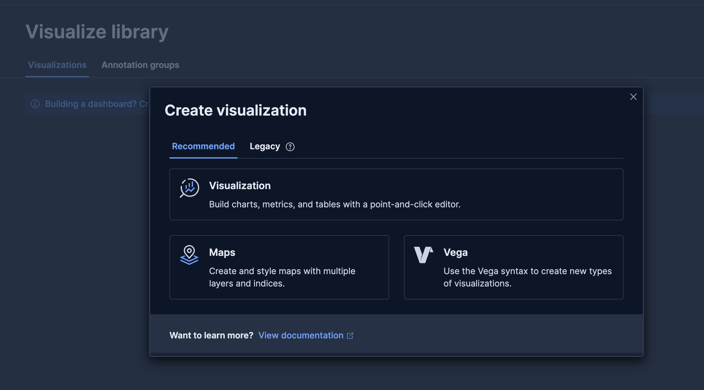
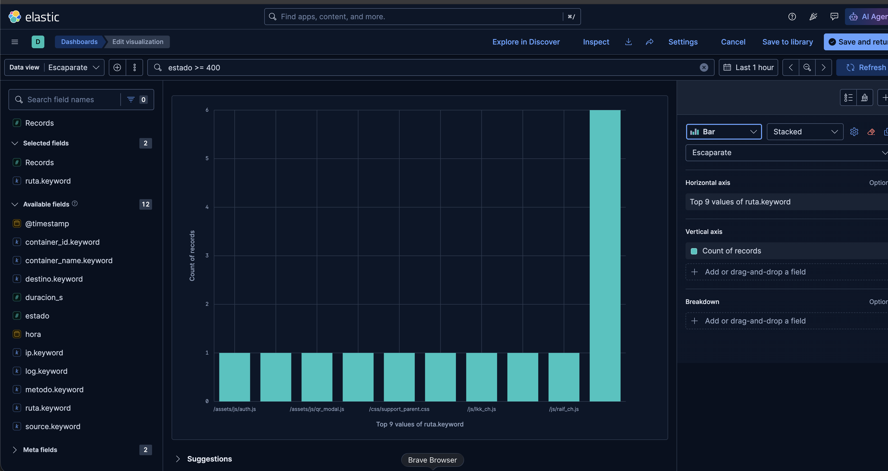
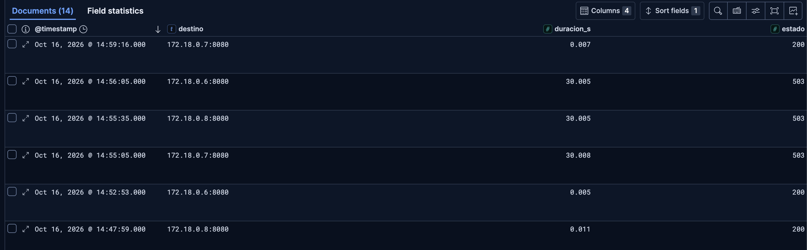

# Actividad 3.4 — Encuentra una incidencia en los registros

## Contexto

Escaparate ya se publica por HTTPS y Nginx reparte las peticiones entre varias réplicas. Cuando un usuario comunica que algo falla o tarda demasiado, abrir la página no basta para saber qué ha ocurrido.

Consultarás los registros del despliegue desde Kibana para relacionar cada petición con su ruta, código de respuesta, duración y destino. Después provocarás una caída controlada de PostgreSQL y utilizarás esos registros para reconocer el fallo y comprobar la recuperación.

## Antes de comenzar

La instalación de Elasticsearch, Fluent Bit y Kibana es soporte para el ejercicio, no un objetivo de administración. La configuración se entrega preparada. El recorrido requiere **Discover, un gráfico y una incidencia**. Todos los apartados forman parte de la actividad.

## 1. Preparación guiada en EC2

Parte de la 3.3 funcionando por HTTPS y fusionada en `main`. Descarga [el soporte de las actividades 3.4 y 3.5](descargas/soporte-tema3.zip) y extráelo en la raíz del repositorio: debe aparecer `soporte-tema3/`. Contiene la pila de observabilidad y los auxiliares de laboratorio.

En EC2, desde la raíz del repositorio, prepara la rama y los directorios:

```bash
git switch main
git pull --ff-only
git switch -c sesion-09
mkdir -p entregas/tema3/actividad-3.4/img practicas/aplicaciones
cp soporte-tema3/comprobar-replicas.sh practicas/aplicaciones/
```

Desde esa misma raíz:

```bash
cp -R soporte-tema3/observabilidad practicas/
cp soporte-tema3/3.4/compose.override.yaml practicas/compose/
chmod 755 practicas/observabilidad/*.sh
chmod 644 practicas/observabilidad/fluent-bit/*.conf practicas/observabilidad/kibana-init.sh
bash practicas/observabilidad/prepara-host.sh
python3 practicas/observabilidad/activar-logs.py
cd practicas/compose
sudo docker compose config --quiet
sudo docker compose pull fluent-bit elasticsearch kibana kibana-init
sudo docker compose up -d fluent-bit elasticsearch kibana kibana-init
sudo docker compose up -d web app-1 app-2 app-3
sudo docker compose exec -T web nginx -t
```

El archivo `compose.override.yaml` se incorpora automáticamente al usar `docker compose` sin `-f`. Consérvalo también en la 3.5. Así no se pierde el envío de logs al recrear una aplicación. El script de preparación configura `vm.max_map_count` y swap de laboratorio; no es una receta de optimización de producción.

Espera al arranque y comprueba:

```bash
sudo docker compose ps -a
curl -fsS http://127.0.0.1:9200/
curl -sS -o /dev/null -w 'Kibana: %{http_code}\n' http://127.0.0.1:5601/api/status
sudo docker compose logs --tail=20 kibana-init
```

Esperamos Elasticsearch saludable, Kibana **200** y `kibana-init` en **Exited (0)** con `Data view Escaparate preparado`. Un `000` durante el arranque no implica que debas reinstalar: espera y consulta los logs. Si el inicializador agotó su espera, cuando Kibana esté preparado ejecuta `sudo docker compose up -d --no-deps --force-recreate kibana-init`.

Kibana, Elasticsearch y Fluent Bit publican sus puertos solo en `127.0.0.1`. **No abras 5601, 9200 ni 24224 en AWS.**

## 2. Abre el túnel desde tu equipo

En una terminal de tu ordenador —no dentro de la sesión SSH de EC2—, sustituye las rutas y la IP:

```bash
ssh -i "/ruta/a/clave.pem" -N -o ExitOnForwardFailure=yes -o ServerAliveInterval=30 -L 127.0.0.1:5602:127.0.0.1:5601 ec2-user@IP_PUBLICA
```

En PowerShell funciona el mismo comando, con una ruta como `C:\ruta\clave.pem`. Déjalo abierto y visita `http://localhost:5602`. Si el puerto local está ocupado, cambia únicamente el primer `5602` por `5603` y abre ese puerto en el navegador. No cambies los puertos de EC2.

## 3. Genera datos e interpreta un documento

En EC2, desde `practicas/compose`, define la URL real:

```bash
read -r -p 'URL HTTPS del catálogo: ' URL
export URL
bash ../observabilidad/genera-trafico.sh "$URL" 60
```

El generador mezcla peticiones correctas, rutas inexistentes y peticiones de distinta duración. Los errores intencionados son parte del experimento.

En Kibana abre **Discover**, selecciona **Escaparate**, elige **Last 15 minutes** y pulsa **Refresh**. Busca:

```text
ruta.keyword: "/api/instancia"
```

Añade como columnas `estado`, `duracion_s` y `destino`. Deben aparecer tres destinos internos. Abre un documento y lee estos campos:

| Campo | Interpretación |
|---|---|
| `ruta` | ruta solicitada, sin los parámetros de consulta |
| `estado` | código HTTP registrado por Nginx |
| `duracion_s` | duración total de la petición vista por Nginx, en segundos |
| `destino` | dirección del backend; puede contener varios intentos |
| `ip` | cliente visto por Nginx |
| `hora` | fecha y hora al escribir el registro |

No confundas duración total con tiempo de CPU de la aplicación. El tiempo `@timestamp` utilizado por la vista procede del flujo de logs. Si repartes la práctica entre sesiones, amplía el intervalo; antes de una incidencia nueva puedes volver a los últimos 15 minutos.

## 4. Crea un único gráfico de errores

Retira los filtros de Discover. Para crear el gráfico sigue esta secuencia de la versión utilizada:

1. **Visualize library → Create new visualization**.
2. En **Recommended**, pulsa la tarjeta **Visualization**. Abre el editor Lens aunque la tarjeta no se llame «Lens».
3. Selecciona **Escaparate** y escribe `estado >= 400` en la barra KQL. Pulsa Enter.
4. Mantén **Bar** y **Stacked**.
5. Arrastra `ruta.keyword` a **Horizontal axis**: operación **Top values**.
6. Arrastra **Records** a **Vertical axis**: operación **Count**.
7. Deja **Breakdown** vacío. No selecciones sugerencias inferiores: pueden cambiar el tipo de gráfico.
8. Guarda el panel como **Errores por ruta** y añádelo a un nuevo dashboard **Observabilidad de Escaparate**. Guarda también el dashboard.





Las cifras y rutas de las capturas son ejemplos, no resultados que debas reproducir exactamente. El servidor público puede recibir tráfico ajeno a nuestras pruebas. `Other` agrupa rutas fuera del Top. Si aparece un aviso de aproximación, puedes mantener el modo de precisión desactivado para esta práctica.

**Atascos habituales:**

- Gráfico vacío: comprueba intervalo, vista y filtros adicionales.
- Una única barra al 100 %: seleccionaste `Percentage` o colocaste las rutas en `Breakdown`; vuelve a `Stacked` y pásalas a `Horizontal axis`.
- Para editar un panel del dashboard: selecciona su configuración y pulsa **Edit in Lens**. Al terminar, **Save and return** y luego **Save** del dashboard.
- Un filtro KQL del dashboard afecta a sus paneles; un filtro guardado dentro de la visualización es propio de ese panel. Mantén el filtro de errores dentro del gráfico.

## 5. Provoca una incidencia y comprueba su recuperación

En EC2:

```bash
bash ../observabilidad/prueba-caida-bd.sh
```

El script detiene PostgreSQL, realiza tres peticiones y vuelve a arrancarlo al terminar. Esperamos **tres 503**, que en la prueba del profesor tardaron unos 30 segundos cada una. El cliente espera hasta 60 segundos.

La recuperación automática cubre la salida normal y las interrupciones manejadas por el script. Si se cierra la conexión o se interrumpe la máquina, comprueba el estado y ejecuta `sudo docker compose start bd` cuando sea necesario.

Después:

```bash
curl --max-time 60 -fsS "$URL/api/salud/listo"
```

Debe volver a responder `{"estado":"ok"}`. Si aún está arrancando, espera y repite.

En Discover filtra:

```text
ruta.keyword: "/api/salud/listo" AND estado >= 500
```

Comprueba estado, duración y destino. Después quita `AND estado >= 500` para ver también el `200` de recuperación. En el gráfico puede quedar agrupada en `Other`; Discover permite encontrarla sin depender del Top.



**Si ves 499 en lugar de 503:** el cliente cerró la conexión antes de recibir la respuesta. Puede ocurrir si utilizas `curl --max-time 15` y la respuesta tarda más de 15 segundos. No demuestra que falten logs: el filtro `estado >= 500` excluye 499. Revisa primero la ruta sin filtrar estado.

## Entrega breve

En `entregas/tema3/actividad-3.4/actividad-3.4.md`, incluye dos capturas guardadas en su carpeta `img/`: un documento con sus campos y la secuencia de error/recuperación. El gráfico debe quedar guardado. Responde en unas 100 palabras:

1. ¿Qué dependencia falló y qué datos permiten reconocerlo?
2. ¿Por qué el túnel permite consultar Kibana sin publicar su puerto hacia Internet?
3. Propón una alerta con umbral, ventana de observación, tiempo durante el que debe mantenerse la condición, destinatario y acción. No configures notificaciones reales.

Ejemplo para discutir, no valor universal: avisar si readiness devuelve 5xx durante dos minutos consecutivos, comprobándolo cada 30 segundos; revisar PostgreSQL antes de reiniciar aplicaciones. Justifica tu propuesta.

## Documenta e integra

Actualiza el README con el acceso por túnel a Kibana y el arranque de la pila. En `entregas/tema3/memoria-publicacion-ejecucion.md` dibuja la arquitectura completa: Nginx, las tres réplicas, PostgreSQL, el volumen compartido y el recorrido de los logs hasta Kibana. Añade una frase sobre la función de cada componente; completarás el diagrama en la siguiente sesión.

No repitas los comandos de esta actividad en esa memoria. Revisa `git status`, conserva la configuración y los scripts en `practicas/`, registra los cambios, publica `sesion-09` y abre la PR hacia `main`. Comprueba los checks y fusiona mediante **Create a merge commit**. No versiones contraseñas, certificados privados ni archivos de cookies.
