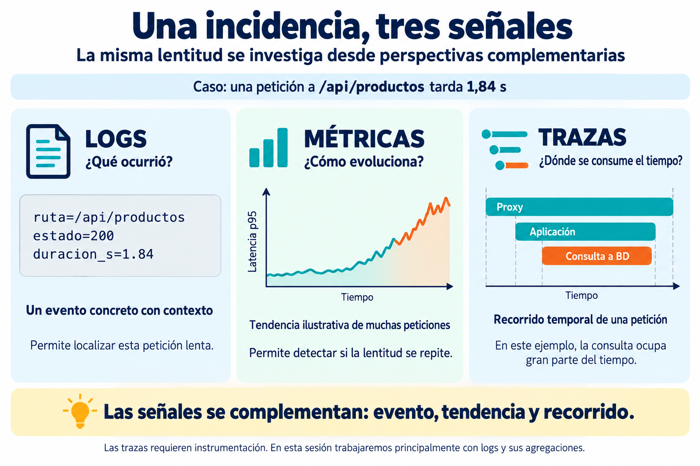
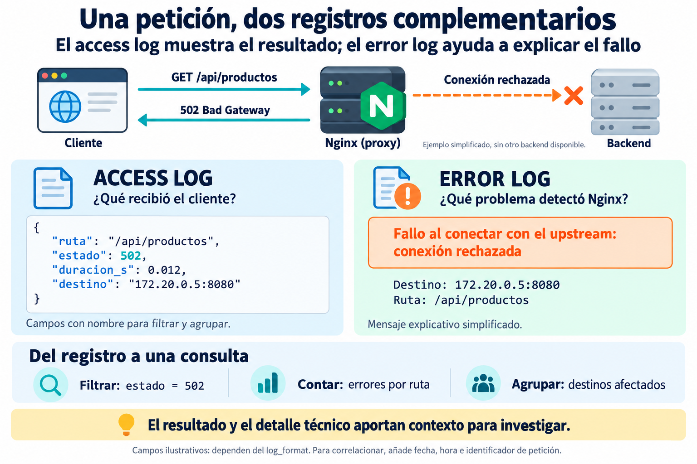
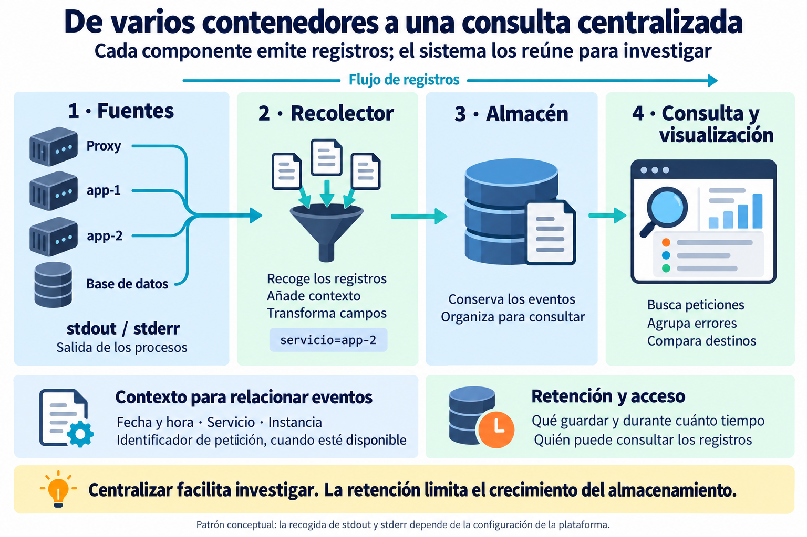
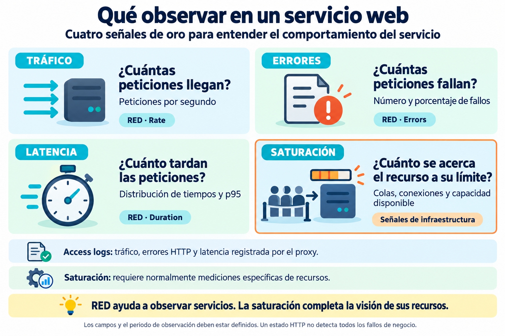
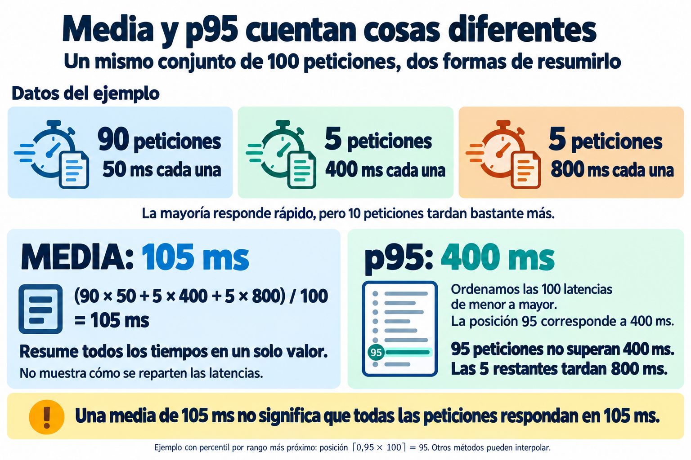
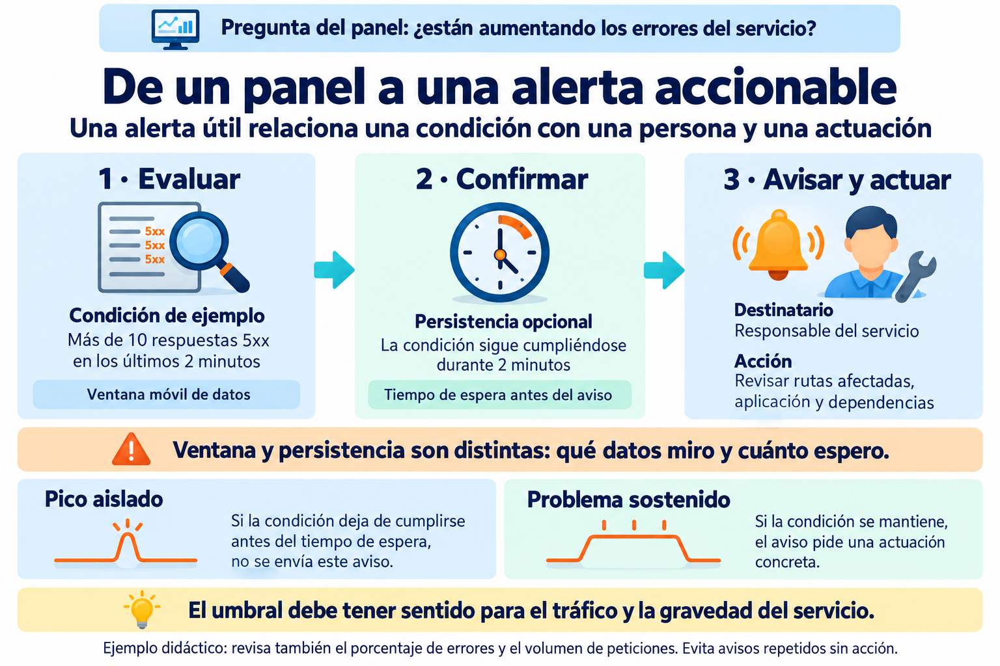

# 👁️ Observabilidad: logs, métricas y alertas

!!! info "Descarga de diapositivas"
    [Descarga las diapositivas](diapositivas/observabilidad.pdf){target="_blank" rel="noopener"}

---

Un servicio puede estar correctamente desplegado y, aun así, ser difícil de administrar si no sabemos qué está ocurriendo.

Decir:

> “La web va mal.”

aporta poco.

Una descripción observable sería más útil:

> “`/api/productos` devuelve más errores `5xx` y el p95 de latencia ha aumentado.”

La **observabilidad** es la capacidad de comprender el estado interno de un sistema a partir de las señales que emite.

---

## 📡 1. Las señales de un sistema

Logs, métricas y trazas permiten investigar un mismo problema desde perspectivas complementarias.



### 1.1. Logs: sucesos con contexto

Un log describe un evento concreto. En la imagen, una petición termina con estado `200`, pero tarda `1,84 s`: una respuesta correcta también puede ser demasiado lenta.

Para investigarla necesitamos contexto, como fecha y hora, servicio, ruta y duración. Un identificador de petición puede ayudar a relacionar registros de distintos componentes si se propaga y registra de forma coherente.

### 1.2. Métricas: valores que evolucionan

Las métricas permiten observar tendencias: peticiones por segundo, porcentaje de errores, latencia o consumo de recursos. Hay que indicar el periodo, la unidad y el conjunto de datos al que se refieren.

La curva de la imagen es ilustrativa y resume muchas peticiones. Un único evento lento no demuestra que el servicio se haya vuelto lento de forma general.

### 1.3. Trazas: recorrido temporal de una petición

Una traza relaciona operaciones de una petición entre componentes. Cada tramo, o **span**, representa una operación y su duración. En la imagen, la consulta a la base de datos ocupa gran parte del tiempo de la aplicación.

Los tramos pueden estar anidados o solaparse: no se suman sin más. Las trazas distribuidas necesitan instrumentación y propagación de contexto; no aparecen automáticamente por centralizar logs.

En esta sesión basta con **reconocer** su utilidad. La práctica se centrará en logs y agregaciones calculadas a partir de ellos.

!!! info "Alcance de la práctica"
    Contar errores y calcular latencias desde logs produce indicadores útiles. No implica que también estemos midiendo CPU, memoria, disco o colas: esas señales requieren fuentes específicas.

---

## 🧾 2. Qué registra un servidor web

Nginx ofrece dos registros con funciones distintas: **access log** y **error log**. Una incidencia puede dejar información en ambos.



### 2.1. Access log: el resultado de la petición

Normalmente se escribe una entrada al finalizar la petición, si el registro está habilitado y la petición no queda excluida por filtros. Los campos dependen del formato configurado; la duración y el destino no aparecen necesariamente en el formato predeterminado.

Es útil registrar método, ruta, estado, duración y fecha. En un proxy también podemos incluir el destino del intento de conexión.

### 2.2. Error log: problemas detectados por Nginx

Puede recoger fallos de conexión con un upstream, errores de permisos o problemas al acceder a ficheros. El nivel de registro y la configuración determinan qué mensajes aparecen.

En la imagen, Nginx no consigue conectar con el backend y devuelve `502` al cliente. El mensaje del error log es una explicación simplificada, no una reproducción literal de su formato.

**No hay una correspondencia obligatoria entre cada respuesta HTTP de error y una entrada en el error log.** Si una aplicación devuelve `500`, el detalle puede estar en el log de la aplicación.

### 2.3. Qué significa la duración

Si usamos `$request_time`, Nginx registra segundos con resolución de milisegundos. Mide desde la lectura de los primeros bytes del cliente hasta la escritura del log tras enviar los últimos bytes de respuesta.

Por tanto, `0.042 s` equivale a `42 ms`, pero no representa exclusivamente tiempo de ejecución del backend ni toda la experiencia del navegador. La recepción de la petición y el envío al cliente también pueden influir.

Referencia: [registro de peticiones en Nginx](https://nginx.org/en/docs/http/ngx_http_log_module.html).

---

## 🧱 3. Del texto libre al log estructurado

Un registro estructurado asigna un nombre a cada dato. Así podemos filtrar por estado, agrupar por ruta y calcular indicadores sobre campos bien definidos.

Ejemplo ilustrativo de una petición correcta:

```json
{
  "fecha": "2026-10-15T10:00:00+00:00",
  "metodo": "GET",
  "ruta": "/api/productos",
  "estado": 200,
  "duracion_s": 0.042,
  "destino": "172.20.0.5:8080"
}
```

El sufijo `_s` hace explícita la unidad. La herramienta de consulta debe interpretar `estado` y `duracion_s` como números para agregarlos correctamente.

### 3.1. Registrar los destinos del proxy

`$upstream_addr` permite conocer las direcciones de los backends contactados. Ayuda a observar cómo se reparte el tráfico, pero hay dos matices:

- Si hubo reintentos, puede contener **varias direcciones**, no solo un backend final.
- Una dirección registrada no demuestra que ese backend devolviera una respuesta correcta: también puede corresponder a un intento fallido.

Para investigar esos casos puede añadirse `$upstream_status` y relacionarlo con los destinos. Una petición servida sin upstream no tendrá un destino de aplicación. Además, las IP de contenedores pueden cambiar: conviene conservar contexto de servicio e instancia.

Referencia: [variables de upstream de Nginx](https://nginx.org/en/docs/http/ngx_http_upstream_module.html#variables).

### 3.2. JSON y escape de caracteres

`escape=json`, dentro de `log_format`, escapa caracteres especiales en los valores. Sigue siendo necesario escribir correctamente las comillas, las comas y los tipos del JSON.

Por ejemplo, dentro del contexto `http` de Nginx:

```nginx
log_format observabilidad escape=json
    '{"fecha":"$time_iso8601",'
    '"metodo":"$request_method",'
    '"ruta":"$uri",'
    '"estado":$status,'
    '"duracion_s":$request_time,'
    '"destino":"$upstream_addr"}';

access_log /dev/stdout observabilidad;
```

Este fragmento orientado a contenedores envía el access log a la salida estándar. Cada evento ocupa una línea, aunque aquí el formato se haya dividido para leerlo mejor. El error log mantiene su configuración independiente.

Se ha elegido `$uri` para no incluir la cadena de consulta. Puede reflejar una URI normalizada o modificada durante el procesamiento. Los campos que puedan contener valores ausentes o varios resultados necesitan un tratamiento adecuado; no deben declararse números sin comprobar sus posibles valores.

Referencia: [formato y escape JSON en Nginx](https://nginx.org/en/docs/http/ngx_http_log_module.html#log_format).

### 3.3. Información que conviene excluir

Contraseñas, tokens, cookies de sesión y datos personales innecesarios no deben incorporarse al registro. También una URL puede contener secretos en su ruta o en sus parámetros.

Evitar la cadena de consulta reduce una fuente de exposición, pero no elimina todas: hay que revisar qué datos emite cada componente. Los logs suelen copiarse y conservarse, por lo que requieren permisos y acceso controlado.

---

## 🗃️ 4. Centralizar registros

Para investigar un despliegue pequeño podemos empezar con:

```bash
docker compose logs --tail=100 -f
```

Compose puede reunir la salida de varios servicios del proyecto. Un sistema de centralización añade búsqueda, conservación y agregaciones más cómodas, especialmente al crecer el número de componentes o de hosts.



Las flechas representan **registros**, no peticiones web. El recolector obtiene los eventos y puede añadir contexto; el almacén los conserva y organiza; la interfaz permite consultarlos y representarlos.

### 4.1. Origen y contexto

En contenedores es habitual escribir en `stdout` y `stderr`. La recogida depende de la configuración de la plataforma y del sistema de logging. Un fichero dentro del contenedor no aparece automáticamente en esa salida.

Para combinar registros conviene conservar la fecha con zona horaria y distinguir servicio e instancia. Los relojes de los hosts deben estar sincronizados para interpretar correctamente el orden de los eventos.

### 4.2. Retención y acceso

Hay que decidir qué guardar, durante cuánto tiempo y quién puede consultarlo. La rotación de archivos locales y la retención del almacén central son decisiones relacionadas, pero distintas.

Una política de retención limita la acumulación histórica. Aun así, es necesario vigilar el volumen de entrada y el espacio disponible: centralizar no evita que el almacenamiento se llene.

---

## 🎯 5. Qué merece nuestra atención

Las **cuatro señales de oro** ofrecen una guía para observar un servicio. RED organiza tres de ellas desde el punto de vista de las peticiones.



### 5.1. RED a partir de access logs

Siempre que se recojan los campos necesarios y el conjunto de peticiones sea representativo:

| Indicador | Ejemplo de cálculo o interpretación |
|---|---|
| **Rate** | Peticiones registradas divididas por los segundos del intervalo. |
| **Errors** | Número de respuestas consideradas fallidas y su porcentaje sobre el total. |
| **Duration** | Distribución de duraciones, media y percentiles. |

Hay que definir qué significa «fallo». Los `5xx` son un indicador útil de errores de servidor; los `4xx` pueden tener significados distintos según la ruta. Una respuesta `200` tampoco garantiza que la operación de negocio sea correcta.

Si se excluyen peticiones del log, se pierden registros o solo se observa una parte del tráfico, las agregaciones describen esa muestra, no necesariamente todo el servicio.

### 5.2. Saturación y recursos

La saturación indica presión sobre un recurso o falta de capacidad, por ejemplo una cola de trabajo creciente o peticiones esperando una conexión disponible.

Utilización y saturación están relacionadas, pero no son idénticas. La CPU ocupada muestra utilización; el trabajo esperando CPU aporta información sobre saturación. Los access logs pueden mostrar síntomas, como latencia, pero normalmente hacen falta mediciones específicas para estudiar los recursos.

!!! info "USE"
    **Utilization, Saturation, Errors** es una guía para observar recursos de infraestructura. Basta con reconocerla en esta sesión; no vamos a instrumentar esos recursos siguiendo USE.

Referencia: [las cuatro señales de oro en Google SRE](https://sre.google/sre-book/monitoring-distributed-systems/).

---

## 📊 6. La media y los percentiles

Una media resume el conjunto, pero no describe cómo se reparten sus valores. Para interpretar la cola de latencias utilizamos también percentiles.



### 6.1. Un único conjunto de datos

En el ejemplo hay 90 peticiones de 50 ms, 5 de 400 ms y 5 de 800 ms. La suma de sus duraciones es 10 500 ms:

```text
Media = (90 × 50 + 5 × 400 + 5 × 800) / 100 = 105 ms
```

La media no coincide con la duración de ninguna petición del ejemplo. Tampoco los 10 500 ms indican cuánto duró la prueba: las peticiones podrían haberse ejecutado concurrentemente.

### 6.2. Interpretar p95

De forma intuitiva, **p95 es un umbral de latencia que aproximadamente el 95 % de las peticiones no supera**. No es la latencia máxima ni la media de las peticiones más lentas.

Para este ejemplo usamos el método de **rango más próximo**: ordenamos los 100 valores y seleccionamos la posición 95. El resultado es `400 ms`. Exactamente 95 peticiones no superan ese tiempo y las 5 restantes tardan `800 ms`.

Otros métodos interpolan y pueden dar otro valor en muestras pequeñas o con saltos. La herramienta y su método deben conocerse al comparar resultados. Lo fundamental en esta sesión es interpretar el percentil, no calcularlo manualmente.

### 6.3. Comparar conjuntos equivalentes

Hay que fijar la ruta o servicio, el intervalo temporal y las unidades. Conviene observar también el número de peticiones: un p95 con muy pocos datos puede variar mucho.

No se obtiene el p95 global haciendo la media de los p95 de cada réplica. Deben combinarse las observaciones o estructuras de distribución adecuadas. También puede ser útil separar respuestas correctas y fallidas: un fallo rápido puede reducir la media aunque el servicio esté empeorando.

---

## 📈 7. Un dashboard debe responder preguntas

Cada visualización debe ayudar a tomar una decisión. Un panel inicial podría organizarse así:

| Pregunta | Visualización útil | Contexto necesario |
|---|---|---|
| ¿Cambió la demanda? | Peticiones por segundo a lo largo del tiempo. | Servicio e intervalo. |
| ¿Dónde se concentran los errores? | Recuento y porcentaje por ruta. | Total de peticiones y definición de fallo. |
| ¿Qué rutas responden lentamente? | Media y p95 por ruta. | Unidades y tamaño de muestra. |
| ¿Qué destinos reciben tráfico? | Peticiones o intentos por destino. | Reintentos y cambios de IP. |

Al comparar paneles hay que mantener el mismo periodo y revisar sus filtros. Agrupar rutas con identificadores variables, como `/productos/123`, puede necesitar normalización para evitar miles de grupos distintos.

Un gráfico señala dónde investigar; por sí solo no demuestra la causa. Desde el panel debemos poder volver a los registros relevantes.

---

## 🚨 8. Alertas: cuándo merece la pena avisar

Un panel espera a que alguien lo consulte. Una alerta evalúa una condición y avisa a una persona que puede actuar.



### 8.1. Decisiones de una alerta

| Elemento | Decisión del ejemplo |
|---|---|
| **Condición y umbral** | Más de 10 respuestas `5xx` del servicio observado. |
| **Ventana de datos** | Los últimos 2 minutos, actualizados en cada evaluación. |
| **Persistencia opcional** | La condición debe seguir cumpliéndose durante 2 minutos antes del aviso. |
| **Destinatario** | Responsable del servicio. |
| **Acción** | Revisar rutas afectadas, aplicación y dependencias. |

El sistema evalúa la regla con una periodicidad configurada. El ejemplo es didáctico: el umbral debe adaptarse al tráfico, a la gravedad y al servicio.

### 8.2. Ventana y persistencia son distintas

La **ventana** decide qué registros se cuentan. La **persistencia** decide cuánto debe mantenerse verdadera la condición antes de notificar.

Por ejemplo, a las 10:04 se cuentan los errores de los últimos dos minutos. Si se supera el umbral, comienza la espera. Para avisar a partir de las 10:06, la condición debe seguir cumpliéndose en las evaluaciones intermedias, cada una con su propia ventana móvil.

No son siempre los mismos errores ni hay que esperar necesariamente cuatro minutos desde que empieza una incidencia. Si la condición deja de cumplirse durante la espera, esta alerta no llega a notificarse. Una persistencia mayor filtra oscilaciones breves, pero también retrasa el aviso.

Esta distinción aparece, por ejemplo, en los [estados pendientes y la opción `for` de Prometheus](https://prometheus.io/docs/prometheus/latest/configuration/alerting_rules/); el concepto puede aplicarse con otras herramientas.

### 8.3. Volumen, gravedad y fatiga

Diez fallos entre veinte peticiones representan una situación distinta de diez entre cien mil. El porcentaje ayuda a contextualizar el recuento, pero con muy poco tráfico también puede resultar engañoso. Por eso se revisan ambos valores y el impacto de la operación.

Los avisos repetidos sin acción producen **fatiga de alertas**. Conviene asignar una respuesta concreta, agrupar avisos relacionados y definir cuándo se considera recuperado el servicio. Una ausencia de datos tampoco demuestra que todo funcione bien: puede haber fallado la propia recogida.

Es útil empezar por síntomas que afectan al servicio, como errores o latencia, y usar las señales de recursos para investigar sus causas.

---

## 💾 9. Observar también tiene coste

La recogida, transformación, almacenamiento y consulta consumen CPU, memoria, disco y trabajo de mantenimiento.

El volumen de registros, el detalle de cada evento, la retención y el número de campos indexados influyen en ese coste. Debemos conservar información suficiente para detectar, explicar y resolver problemas, revisando periódicamente su utilidad.

Reducir datos exige conocer las consecuencias: un muestreo o un filtro puede limitar la investigación de casos concretos y cambiar la interpretación de los indicadores.

---

## 🎯 Qué debes saber hacer al salir de esta sesión

Al terminar, deberías poder:

- Explicar qué significa observabilidad.
- Distinguir logs, métricas y trazas.
- Diferenciar access log y error log.
- Explicar por qué un log estructurado facilita consultas y agregaciones.
- Identificar información que no debería registrarse.
- Explicar el patrón recolector → almacén → visualización.
- Reconocer latencia, tráfico, errores y saturación.
- Aplicar RED a un servicio web.
- Interpretar una media y un p95.
- Explicar qué pregunta debe responder una visualización.
- Diseñar una alerta con umbral, ventana, destinatario y acción.
- Distinguir la ventana de datos del tiempo de persistencia de una condición.
- Explicar qué es la fatiga de alertas.
- Reconocer que la observabilidad también consume recursos.

Lo que basta con **reconocer**:

- trazas distribuidas;
- identificadores de petición;
- USE para recursos;
- sistemas específicos de métricas de infraestructura;
- políticas avanzadas de retención;
- plataformas APM.

---

## ✅ Ideas clave

??? tip "Abrir resumen"

    - La observabilidad permite comprender un sistema a partir de las señales que emite.
    - Logs, métricas y trazas responden preguntas distintas y complementarias.
    - Un access log puede registrar ruta, estado, duración y backend utilizado.
    - Un log estructurado convierte texto en campos que pueden filtrarse y agregarse.
    - Los registros de varias piezas pueden centralizarse mediante recolector → almacén → visualización.
    - Latencia, tráfico, errores y saturación son señales útiles de salud.
    - RED ayuda a observar servicios: tasa, errores y duración.
    - La media puede ocultar peticiones lentas; p95 ayuda a observar la cola.
    - Un dashboard debe responder preguntas, no acumular gráficos.
    - Una alerta útil necesita umbral, ventana, destinatario y acción. La persistencia es una decisión adicional.
    - Alertar demasiado produce fatiga y reduce el valor de los avisos.
    - Recoger y conservar observabilidad también tiene coste.

---

En la actividad aplicarás estos patrones a un despliegue con varias réplicas: centralizarás logs, estructurarás el registro de acceso, comprobarás qué backend atiende cada petición, compararás media y p95 y utilizarás incidencias controladas para razonar sobre alertas.

La sesión siguiente cambiará el punto de vista: después de observar la entrada y el tráfico, miraremos **dentro del backend** para entender qué ejecuta cada réplica, dónde vive su estado y cómo interpretar una prueba sencilla de rendimiento.
