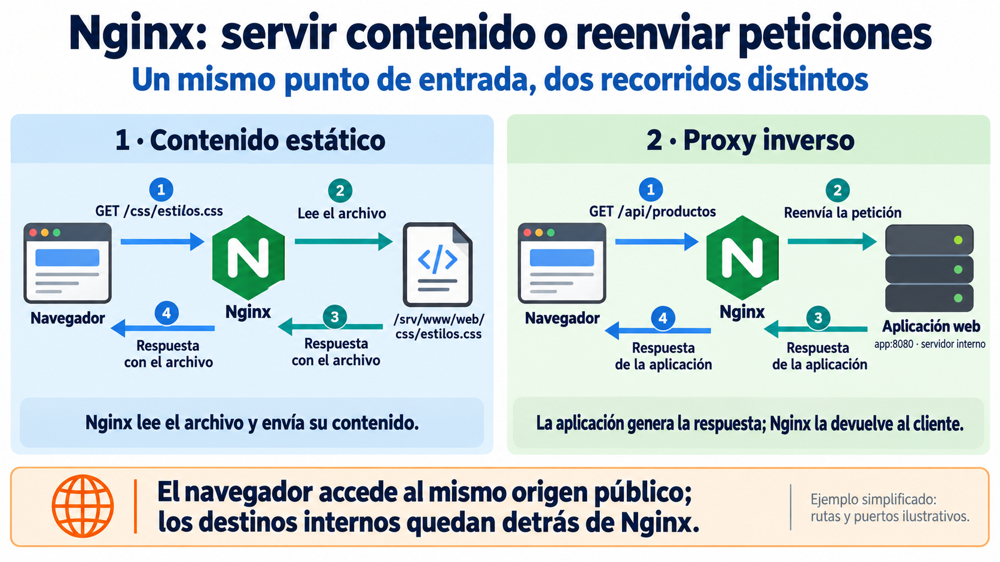
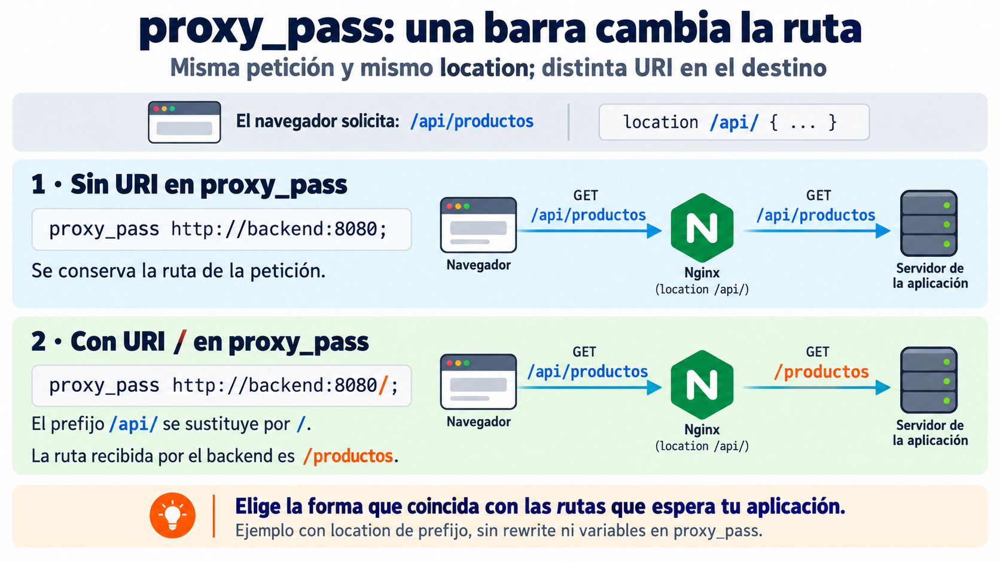
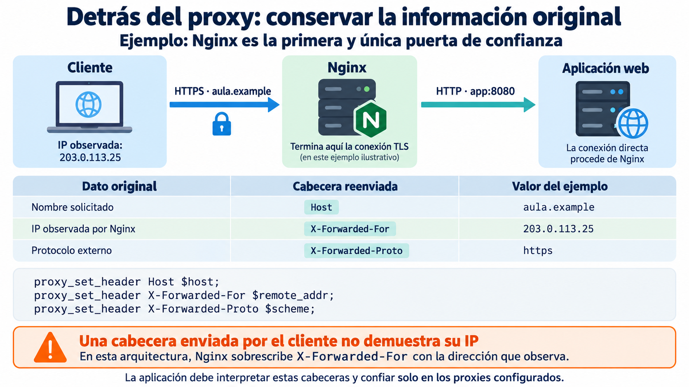
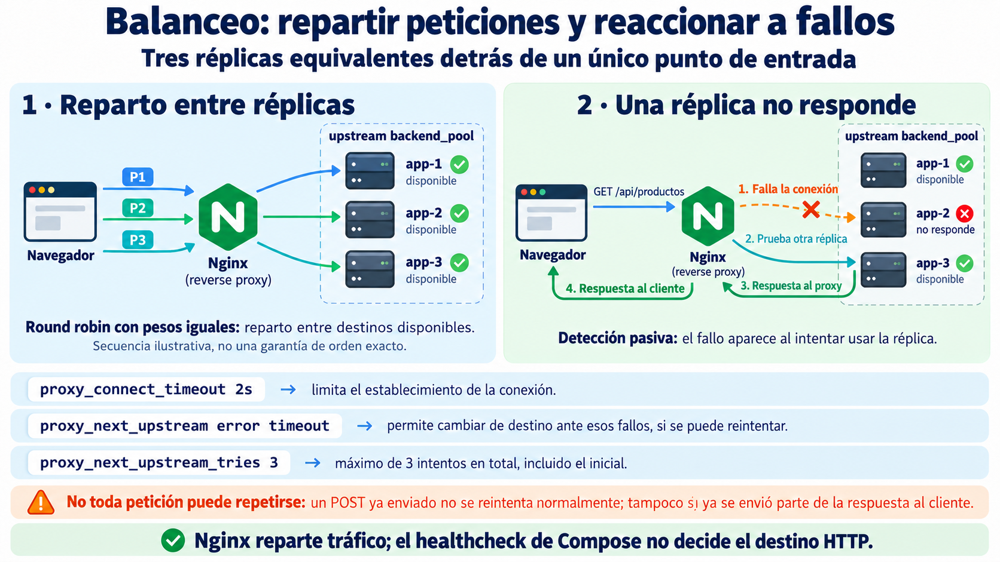
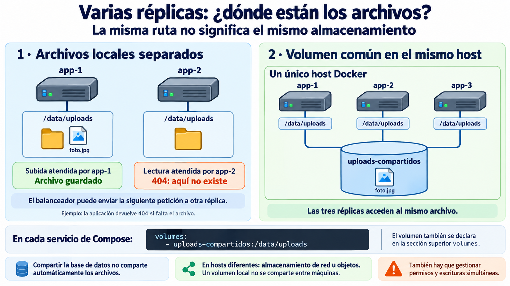
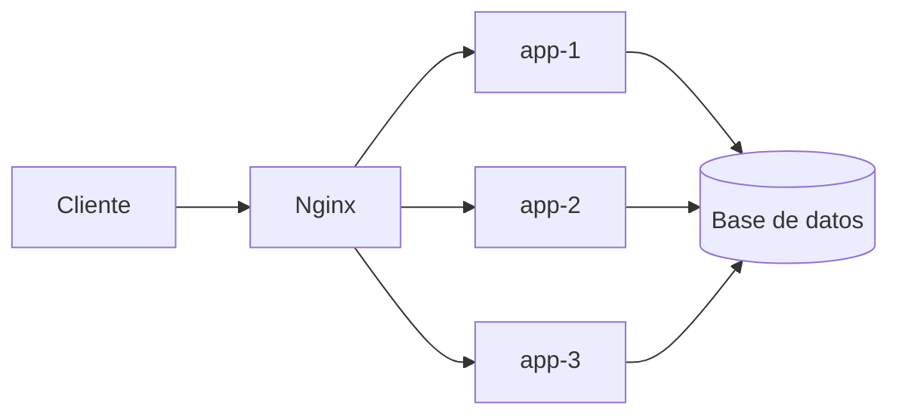

# 🔀 Proxy inverso y balanceo

!!! info "Descarga de diapositivas"
    [Descarga las diapositivas](diapositivas/proxy-inverso-balanceo.pdf){target="_blank" rel="noopener"}

---

En la sesión anterior Nginx actuó como servidor web y puerta de entrada. Ahora añadiremos un segundo papel: **reenviar peticiones a aplicaciones internas**. Cuando un servidor recibe tráfico y lo dirige hacia uno o varios backends hablamos de proxy inverso.

Los backends son aplicaciones que atienden peticiones HTTP. Pueden estar implementadas con Java, Python, JavaScript u otras tecnologías. Nginx recibe la petición pública y coopera con esos servidores internos.

Si existen varias copias equivalentes del backend, el mismo punto de entrada puede repartir entre ellas las peticiones. Esto introduce dos problemas que estudiaremos juntos: qué ocurre cuando una copia deja de responder y qué pasa si una réplica guarda localmente datos que después necesita cualquiera de las demás.

!!! abstract "Mapa de la sesión"
    **Recibir → reenviar → conservar información → repartir → gestionar fallos → compartir estado**

    Usaremos nombres como `app-1` y rutas como `/api/productos` para ilustrar los conceptos. No dependen de una aplicación concreta.

---

## 🔁 1. Proxy inverso

### 1.1. Servir y reenviar son trabajos diferentes

Nginx puede atender una petición leyendo un archivo o reenviándola a una aplicación. La diferencia está en **quién obtiene o genera el contenido de la respuesta**.



*Figura 1. Dos recorridos detrás del mismo punto de entrada.*

En el primer caso, Nginx lee el archivo. En el segundo, el backend procesa la petición y Nginx devuelve su respuesta. **El navegador se comunica con Nginx en ambos casos**: no necesita conocer el nombre interno `app` ni su puerto 8080.

Conviene reconocer la diferencia:

| | Proxy directo | Proxy inverso |
|---|---|---|
| Se coloca | del lado del cliente | delante de los servidores |
| Representa | al cliente | al servicio publicado |
| Ejemplo | proxy de salida de una organización | Nginx delante de una aplicación |

En esta sesión trabajaremos únicamente con **proxy inverso**.

### 1.2. Una sola puerta permite separar responsabilidades

Con un proxy inverso podemos decidir qué hacer según la petición:

| Ruta | Destino |
|---|---|
| `/` | ficheros del frontend |
| `/css/...` | ficheros del frontend |
| `/api/...` | aplicación |

Esto aporta varias ventajas que iremos utilizando durante el módulo:

- una sola entrada pública;
- componentes internos sin puertos publicados;
- reparto entre varias copias;
- un único punto para TLS;
- un lugar común donde registrar el tráfico.

---

## 🔍 2. `location` y `proxy_pass`

### 2.1. La ruta que llega al backend

Un ejemplo mínimo es:

```nginx
location /api/ {
    proxy_pass http://backend:8080;
}
```

En este ejemplo sencillo, el `location` de prefijo selecciona las rutas que empiezan por `/api/`. `proxy_pass` indica a qué destino deben enviarse.

Hay un detalle pequeño con consecuencias importantes: **la URI escrita en `proxy_pass` modifica cómo Nginx construye la ruta del destino**.



*Figura 2. La barra tras el puerto introduce una URI en `proxy_pass`.*

Para la petición `/api/productos`, el primer caso conserva `/api/productos`; el segundo sustituye el prefijo que coincide con `location` por `/` y produce `/productos`.

Si el backend publica realmente sus endpoints bajo `/api`, debemos conservar esa parte de la ruta:

```nginx
proxy_pass http://backend:8080;
```

Un `404` que solo aparece al atravesar el proxy es una pista para revisar esta diferencia, aunque puede tener otras causas. La comparación presupone un `location` de prefijo, sin reescrituras ni variables en `proxy_pass`.

### 2.2. El backend ya no habla con el cliente

Al introducir un proxy, la conexión que recibe el backend procede de Nginx. Si no hacemos nada, la aplicación pierde información sobre la petición original.

Por eso Nginx puede reenviar información sobre el host, la dirección observada y el protocolo externo. En esta sesión basta con comprender qué problema resuelven esas cabeceras; la aplicación debe configurarse para interpretar la información reenviada y confiar únicamente en sus proxies conocidos.



*Figura 3. La conexión procede del proxy, pero las cabeceras permiten describir la petición original.*

La figura anticipa un ejemplo con HTTPS hasta Nginx y HTTP en la conexión interna. Así se entiende por qué el backend necesita conocer el protocolo **externo**. La configuración de HTTPS se trabajará en la siguiente sesión; si el cliente accede por HTTP, `$scheme` tendrá el valor `http`.

Una configuración habitual cuando Nginx es **la primera y única puerta de confianza** es:

```nginx
proxy_set_header Host              $host;
proxy_set_header X-Forwarded-For   $remote_addr;
proxy_set_header X-Forwarded-Proto $scheme;
```

`$remote_addr` es la dirección del extremo que conecta con Nginx. Puede ser la dirección pública de un router que hace NAT, no necesariamente la dirección privada del dispositivo. Reenviarla en una cabecera no cambia la IP de la conexión que recibe el backend: esa conexión sigue procediendo de Nginx.

!!! danger "No confíes en una cabecera porque venga escrita"
    Un cliente puede enviar por sí mismo `X-Forwarded-For: 1.2.3.4`. Si Nginx es la primera puerta de confianza, puede sobrescribir ese dato con la dirección que él mismo ha observado. En arquitecturas con varios proxies de confianza se conserva una cadena de direcciones, pero para hacerlo correctamente hay que saber qué intermediarios son fiables.

`Host` es una cabecera estándar de HTTP. Las cabeceras `X-Forwarded-*` son convenciones ampliamente utilizadas; existe también la cabecera estándar `Forwarded`.

---

## ⚖️ 3. Varias copias detrás de Nginx

### 3.1. Un nombre para las tres copias

En lugar de reenviar `/api/` a una única aplicación, vamos a crear un grupo llamado `backend_pool`.

Este ejemplo utiliza tres servicios en la misma red de Docker Compose. El bloque `upstream` se declara dentro del contexto `http` de Nginx, al mismo nivel que los bloques `server`:

```nginx
upstream backend_pool {
    zone backend_pool 64k;
    resolver 127.0.0.11 valid=5s ipv6=off;

    server app-1:8080 resolve;
    server app-2:8080 resolve;
    server app-3:8080 resolve;
}
```

`upstream` simplemente da un nombre al grupo. Si no indicamos otro método, Nginx utiliza round robin ponderado. Con pesos iguales, reparte las peticiones entre los miembros disponibles. No implica que todas las peticiones cuesten lo mismo ni que siempre observemos una secuencia exacta 1–2–3.

Para observar el reparto, una aplicación puede exponer un endpoint como:

```text
/api/instancia
```

para poder ver qué copia ha respondido. Esta ruta es ilustrativa: la aplicación debe implementarla; Nginx no crea el endpoint.

### 3.2. Por qué aparecen `zone`, `resolver` y `resolve`

Docker Compose nos permite hablar de `app-1`, `app-2` y `app-3` por nombre. Esos nombres son estables, pero la dirección IP interna de un contenedor puede cambiar cuando se recrea.

Queremos que Nginx siga los **nombres**, no una dirección antigua.

Las tres piezas necesarias son:

| Directiva | Idea sencilla |
|---|---|
| `resolver 127.0.0.11` | pregunta al DNS interno de Docker |
| `resolve` | supervisa cambios DNS y actualiza las direcciones del grupo |
| `zone` | comparte la configuración y el estado del grupo entre procesos de Nginx |

`valid=5s` fija en cinco segundos la validez de las respuestas DNS almacenadas. **No comprueba si la aplicación está sana.** `ipv6=off` evita consultas IPv6 en este ejemplo.

!!! info "Entorno del ejemplo"
    Esta configuración requiere Nginx de código abierto **1.27.3 o posterior**. `127.0.0.11` es el DNS integrado de Docker en redes personalizadas, como la red habitual de Compose. Fuera de ese entorno hay que configurar el resolver correspondiente.

No hace falta memorizar estas directivas. Lo importante es entender el problema que resuelven:


### 3.3. Reenvío al grupo y límites de los intentos

Dentro del bloque `server` que atiende al cliente, el `location` de `/api/` queda:

```nginx
location /api/ {
    proxy_pass http://backend_pool;

    proxy_connect_timeout 2s;
    proxy_next_upstream error timeout;
    proxy_next_upstream_tries 3;

    proxy_set_header Host              $host;
    proxy_set_header X-Forwarded-For   $remote_addr;
    proxy_set_header X-Forwarded-Proto $scheme;
}
```

Estos fragmentos se integran en la configuración del servidor; no constituyen por sí solos un `nginx.conf` completo.

Las directivas de timeout y reintento controlan el establecimiento de conexión y los intentos de usar otro destino. **`proxy_connect_timeout 2s` limita la conexión con el backend**, no el tiempo total de respuesta. Una aplicación que acepta la conexión pero tarda en responder requiere analizar también los tiempos de lectura.


`proxy_next_upstream_tries 3` establece un máximo de tres intentos en total, incluido el inicial. No son tres reintentos adicionales ni una garantía de éxito.

!!! note "No toda petición se puede repetir"
    El cambio a otro backend solo es posible antes de enviar parte de la respuesta al cliente. Por defecto, una petición no idempotente, como un `POST`, no se reenvía a otro servidor si ya se había enviado al primero. Repetir una operación de escritura puede duplicar sus efectos. Los códigos HTTP 500 o 503 no provocan por sí solos un reintento con la configuración `error timeout`.

---

## ❤️ 4. Qué ocurre cuando una copia falla

Nginx utiliza aquí una comprobación **pasiva**: no pregunta continuamente si las copias están sanas. Descubre un problema cuando intenta enviarles tráfico.



*Figura 4. El reparto y la detección pasiva de fallos utilizan peticiones reales.*

Si `app-2` se detiene, una petición puede intentar conectarse a ella antes de que Nginx haya detectado el fallo. Una conexión rechazada puede fallar inmediatamente; si no llega a establecerse, actúa el timeout de conexión. **Probar otra réplica depende de que el reintento esté permitido.** Si no queda ningún destino utilizable, el cliente puede recibir un error.

Los fallos pasivos pueden excluir temporalmente un destino del reparto. Esto se controla mediante `max_fails` y `fail_timeout`; por defecto, un intento fallido dentro de una ventana de diez segundos permite considerar el destino no disponible durante diez segundos. No es un sondeo periódico de readiness.

Si `app-2` vuelve con otra IP, `resolver` + `resolve` actualizan su dirección sin reiniciar el proxy. La resolución DNS y la recuperación tras un fallo son mecanismos diferentes: conocer su IP no garantiza que la aplicación esté lista; una nueva petición permite comprobar si responde.

**No es lo mismo que el `healthcheck` de Compose.**

Ya utilizaste un `healthcheck` con PostgreSQL. Se parecen, pero hacen trabajos diferentes:

| | Compose | Nginx |
|---|---|---|
| Para qué lo usamos | observar salud y condicionar el arranque con `service_healthy` | repartir peticiones y evitar temporalmente destinos fallidos |
| Cómo detecta el problema | Docker ejecuta periódicamente la comprobación definida | se produce un fallo al tramitar tráfico real |
| Quién decide el destino HTTP | no lo hace | Nginx |

La idea importante es sencilla:

> El healthcheck informa del estado; Nginx decide el destino de cada petición.

Marcar un contenedor como `unhealthy` no hace que este Nginx consulte automáticamente ese estado ni retire la réplica. Tampoco implica por sí solo reiniciar el contenedor.

Las comprobaciones activas periódicas existen en otros balanceadores y servicios cloud. Aquí basta con entender el comportamiento pasivo que acabamos de configurar.

---

## 🧺 5. El problema del estado local

### 5.1. Tres copias no comparten su sistema de ficheros

Supón una aplicación que permite subir ficheros y los guarda en el filesystem. Una aplicación que interprete estas variables podría utilizar:

```text
STORAGE_TYPE=filesystem
STORAGE_PATH=/data/uploads
```

Estos nombres de variable son ilustrativos: solo funcionan si la aplicación los interpreta. Docker no añade esa lógica.

Si cada réplica escribe en su propio sistema de archivos, utilizar la misma ruta `/data/uploads` **no significa acceder al mismo almacenamiento**.



*Figura 5. La ruta dentro del contenedor y el origen del almacenamiento son decisiones diferentes.*

Una subida puede llegar a `app-1` y una lectura posterior a `app-2`. Si el archivo solo existe en la primera, la segunda puede responder `404`. El resultado depende de la réplica que atienda la petición.

La base de datos puede ser común y registrar una referencia al archivo. **Eso no copia el archivo físico** al almacenamiento de las demás réplicas.

### 5.2. Estado compartido en un único host

Mientras las tres copias viven en el mismo host Docker, podemos montar un **volumen con nombre común**, como en la parte derecha de la figura. Este fragmento muestra únicamente los montajes y la declaración del volumen:

```yaml
services:
  app-1:
    volumes:
      - uploads-compartidos:/data/uploads

  app-2:
    volumes:
      - uploads-compartidos:/data/uploads

  app-3:
    volumes:
      - uploads-compartidos:/data/uploads

volumes:
  uploads-compartidos:
```

Las tres copias ven los mismos ficheros. También necesitan permisos adecuados y una aplicación que gestione los accesos concurrentes: compartir un volumen no resuelve por sí solo las escrituras simultáneas ni crea una copia de seguridad.

La regla general es:

> Si varias copias deben ser intercambiables, el estado que todas necesiten recuperar no debe vivir únicamente dentro de una de ellas.

Este volumen local resuelve el acceso compartido **porque las tres réplicas están en la misma máquina**. Si ya existen archivos en el almacenamiento anterior, hay que trasladarlos al nuevo almacenamiento; añadir el montaje no los reúne automáticamente. Cuando las copias vivan en hosts diferentes necesitaremos otro tipo de almacenamiento compartido, como un sistema de ficheros de red o almacenamiento de objetos.

---

## 🚪 6. Una sola puerta facilita el siguiente paso

El proxy inverso concentra el tráfico de entrada en un único componente:



Los servicios internos no necesitan publicar sus puertos hacia el anfitrión para comunicarse dentro de la red de Docker.

Esta concentración tendrá una consecuencia importante en la siguiente sesión: cuando el sistema se despliegue en una máquina accesible desde Internet, podremos aplicar **HTTPS y control de acceso en Nginx** sin configurar esas responsabilidades de forma independiente en cada réplica.

El principio general es:

> **Una sola puerta pública permite aplicar una política común de entrada.**

Tener varias réplicas de la aplicación no hace que todo el sistema sea altamente disponible: un único proxy, host o servidor de base de datos puede seguir siendo un punto único de fallo.

---

## 🎯 Qué debes saber hacer al salir de esta sesión

Al terminar, deberías poder:

- Explicar la diferencia entre servir contenido y actuar como proxy inverso.
- Predecir qué ruta recibirá el backend según la forma de `proxy_pass`.
- Explicar por qué el backend necesita recibir información de la petición original mediante cabeceras reenviadas.
- Declarar un `upstream` con varias copias y comprobar el reparto mediante un endpoint que identifique la réplica.
- Explicar por qué Nginx debe poder volver a resolver los nombres de los contenedores.
- Comprobar qué ocurre cuando una réplica deja de responder y cómo el proxy puede probar otra.
- Diferenciar el `healthcheck` de Compose de la detección pasiva de fallos del proxy.
- Diagnosticar por qué un fichero local puede aparecer y desaparecer cuando varias réplicas atienden peticiones.
- Resolver ese problema compartiendo almacenamiento entre réplicas del mismo host.
- Explicar por qué un volumen Docker compartido deja de ser suficiente si las réplicas viven en máquinas distintas.
- Mantener una única puerta publicada hacia el anfitrión.

Lo que basta con **reconocer**:

- la diferencia general entre proxy directo y proxy inverso;
- que existen otros algoritmos de balanceo;
- que existen comprobaciones activas de salud;
- que un sistema distribuido entre varios hosts necesita soluciones de almacenamiento compartido distintas de un volumen local de Docker;
- los detalles de `zone`, `resolver`, `resolve` y las directivas de reintento.

---

## ✅ Ideas clave

??? tip "Abrir resumen"

    - Un proxy inverso recibe peticiones del cliente y las reenvía hacia aplicaciones internas.
    - `location` decide qué peticiones se reenvían y `proxy_pass` determina el destino.
    - Una `/` final en `proxy_pass` puede modificar la URI que recibe el backend.
    - El backend habla directamente con Nginx, no con el navegador; por eso pueden reenviarse `Host`, la IP observada y el protocolo original.
    - Un `upstream` agrupa varias réplicas detrás de un único nombre.
    - Si no se indica otro algoritmo, Nginx reparte las peticiones entre los miembros del grupo.
    - Los nombres de los servicios son estables, pero las IP internas de los contenedores pueden cambiar; por eso interesa resolver de nuevo esos nombres.
    - La detección de fallos usada aquí es pasiva: Nginx descubre que una réplica falla al intentar utilizarla.
    - El timeout de conexión y los reintentos controlan parte del tratamiento de fallos; no garantizan el tiempo total ni el éxito de cualquier petición.
    - Varias réplicas no comparten automáticamente su filesystem.
    - Si cualquier réplica debe poder recuperar un dato, ese dato no puede vivir únicamente dentro de una de ellas.
    - Un volumen común resuelve el problema mientras las réplicas comparten host.
    - Nginx sigue siendo la única puerta publicada; las réplicas y la base de datos permanecen en la red interna.


---

En la actividad aplicarás este patrón general al proyecto del módulo: varias réplicas de una aplicación detrás de Nginx, detección pasiva de fallos y almacenamiento compartido entre copias del mismo host. El despliegue en una máquina pública se reserva para la siguiente sesión, donde trabajaremos HTTPS y certificados en un entorno público.


## 📚 Referencias

- [Nginx: proxy HTTP, rutas y reintentos](https://nginx.org/en/docs/http/ngx_http_proxy_module.html).
- [Nginx: grupos upstream, DNS y fallos pasivos](https://nginx.org/en/docs/http/ngx_http_upstream_module.html).
- [Docker: redes y DNS de contenedores](https://docs.docker.com/engine/network/).
