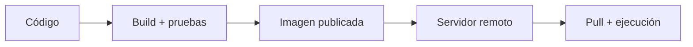
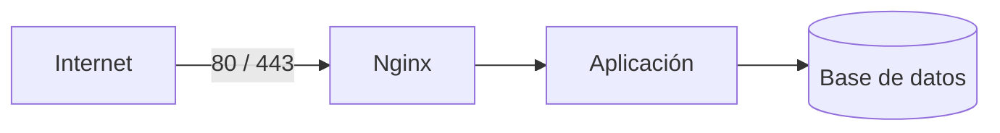
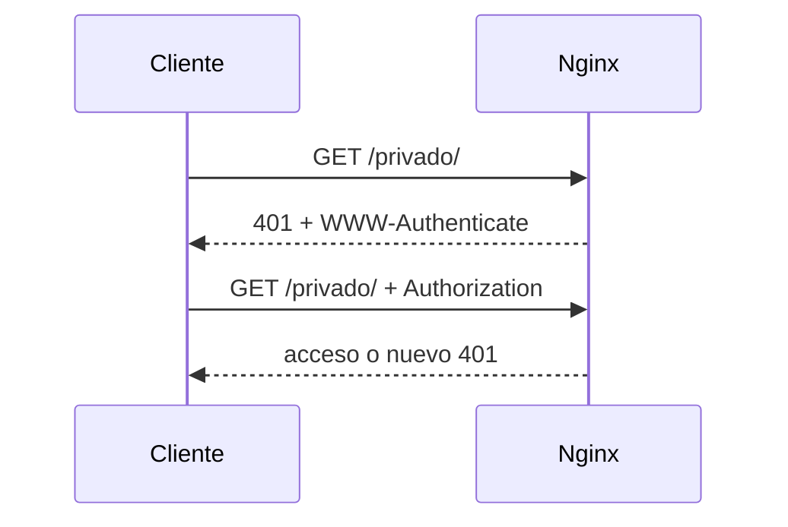
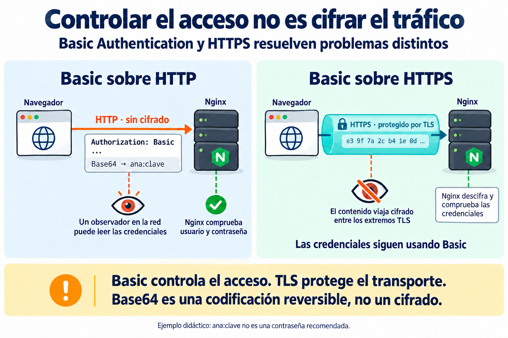
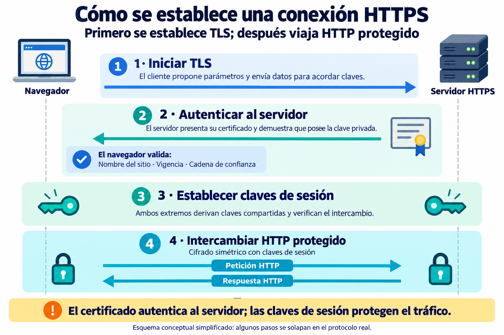
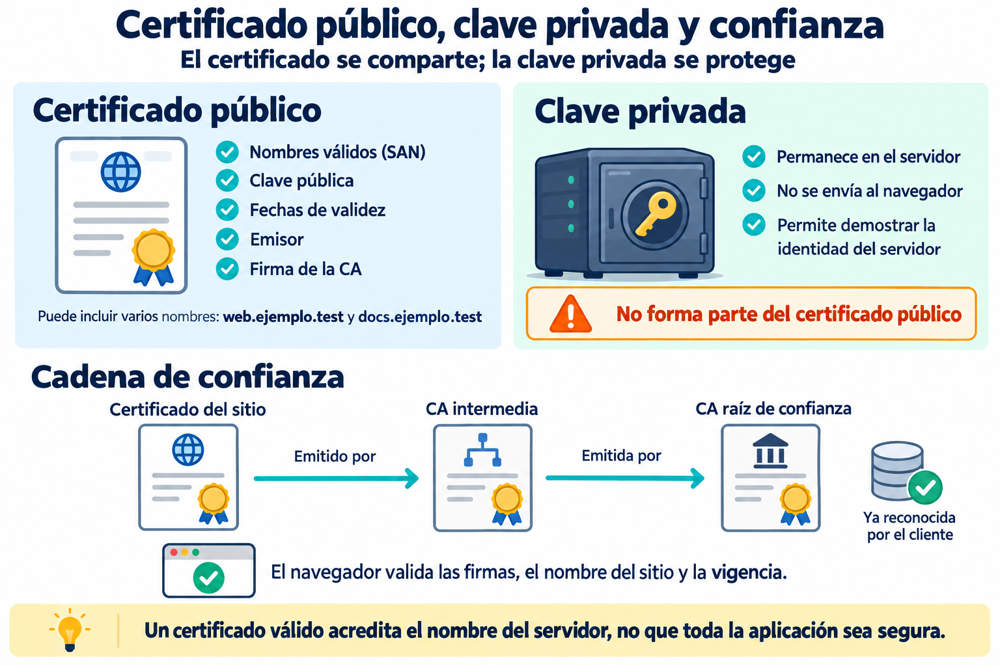
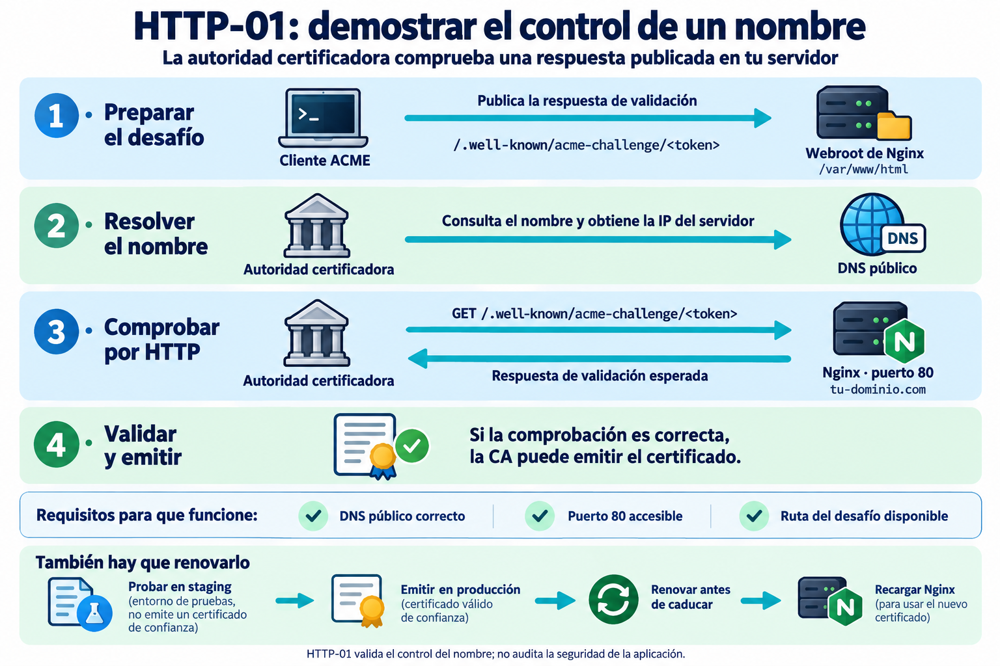
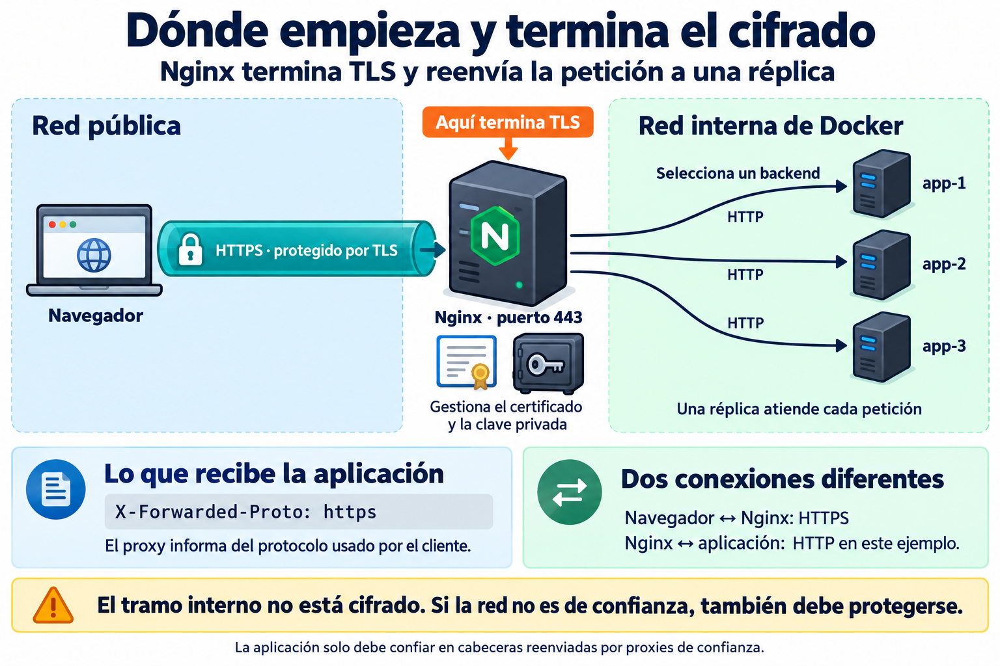
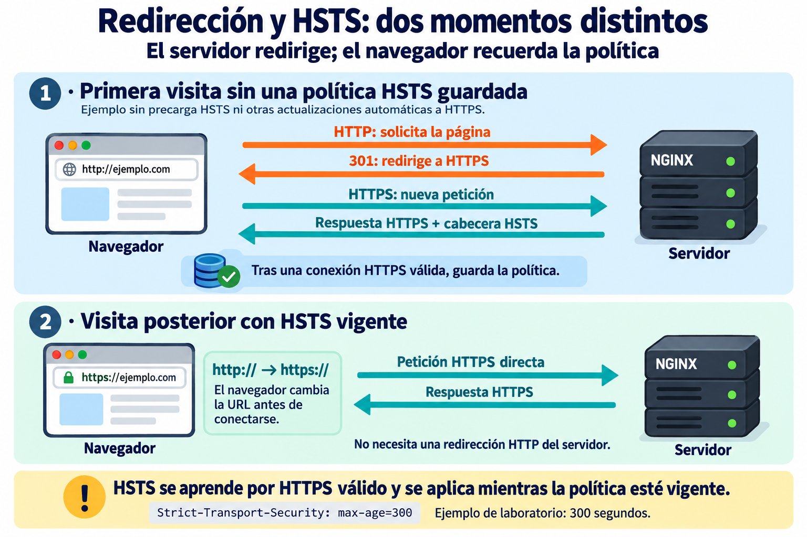

# 🔒 Seguridad web y HTTPS

!!! info "Descarga de diapositivas"
    [Descarga las diapositivas](diapositivas/seguridad-web-https.pdf){target="_blank" rel="noopener"}

---

Publicar una aplicación no consiste solo en conseguir que responda. Cuando un servicio pasa de un entorno local a una máquina accesible desde Internet aparecen dos preguntas nuevas:

- **¿Quién puede acceder?**
- **¿Cómo protegemos el tráfico mientras viaja?**

En esta sesión estudiaremos ambas capas. Antes veremos también qué cambia —y qué no— al trasladar un despliegue Docker desde nuestro equipo a un host remoto.

---

## 🚀 1. Del laboratorio local a un host remoto

Un despliegue reproducible no debería depender de reconstruir manualmente la aplicación en cada servidor.

El flujo habitual es:



El servidor de destino necesita:

- un motor de contenedores;
- la descripción del despliegue;
- la configuración necesaria;
- acceso a las imágenes publicadas.

No necesita instalar en el host las herramientas de compilación ni copiar el código fuente para ejecutar una imagen ya construida. La imagen debe incluir su entorno de ejecución y ser compatible con la plataforma de destino.

### 1.1. Publicar un puerto abre una entrada al host

Esta configuración publica el puerto 80 del contenedor en el puerto 80 del host:

```yaml
ports:
  - "80:80"
```

Por defecto, Docker lo publica en todas las interfaces del host. También en nuestro equipo puede ser accesible desde otros dispositivos: dependerá de la red y de las reglas de acceso. En un servidor con IP pública, puede quedar expuesto a Internet.

Si solo queremos acceder desde el propio host durante una prueba local:

```yaml
ports:
  - "127.0.0.1:8080:80"
```

En el despliegue público mantenemos una única entrada web:



Solo Nginx publica los puertos web. Las aplicaciones y la base de datos se comunican mediante redes de Docker, sin publicar sus puertos al exterior. Las reglas de red del proveedor y del host también deben permitir las conexiones previstas.

Esta arquitectura sirve para aplicaciones implementadas con tecnologías diferentes: basta con que el backend atienda HTTP. Más adelante veremos cómo Nginx termina TLS y reenvía las peticiones internamente.

### 1.2. Un nombre debe resolver públicamente

Para acceder por nombre, el DNS debe apuntar a la IP pública del servidor. En un laboratorio puede utilizarse un servicio DNS comodín, con nombres que incorporan la IP, en lugar de registrar un dominio propio.

El patrón sería `web.<IP-pública>.<servicio-DNS>`, sustituyendo los marcadores por valores reales según el servicio elegido. Si cambia la IP pública, habrá que revisar los nombres y el despliegue.

En estos apuntes utilizaremos `web.ejemplo.test` y `docs.ejemplo.test` como **nombres ilustrativos**. No sirven para solicitar certificados públicos: en la práctica se sustituyen por nombres públicos cuyo control podamos demostrar. Del mismo modo, `203.0.113.25` es una IP reservada para documentación, no una dirección de un servidor de prácticas.

El DNS lleva al cliente hasta la máquina. Nginx selecciona el sitio HTTP mediante `Host`; en HTTPS, el nombre enviado durante TLS mediante SNI permite seleccionar el certificado antes de recibir la petición HTTP.

Referencia: [publicación de puertos en Docker](https://docs.docker.com/engine/network/port-publishing/).

---

## 🔐 2. Control de acceso en el servidor web

Un servidor web puede proteger una ruta sin modificar la aplicación.

El intercambio básico es:



Con Basic Authentication, la cabecera tiene la forma `Authorization: Basic <valor>`. Ese valor es la codificación Base64 de:

```text
usuario:contraseña
```

Base64 **no cifra**. Es una codificación reversible.

| Petición | Resultado habitual |
|---|---|
| Sin credenciales | `401 Unauthorized` |
| Credenciales incorrectas | `401 Unauthorized` |
| Credenciales correctas | la petición continúa |

Las siguientes directivas se añaden al `location` que sirve el contenido o reenvía la petición. No sustituyen la configuración de ese contenido:

```nginx
location /privado/ {
    auth_basic "Zona restringida";
    auth_basic_user_file /etc/nginx/auth/usuarios.htpasswd;
}
```

El fichero de usuarios contiene líneas como:

```text
usuario:hash-de-la-contraseña
```

El fichero se genera con una herramienta como `htpasswd`, usando un formato de hash compatible. Aunque la contraseña no esté guardada en claro, sigue siendo **material sensible**: debe tener permisos limitados y quedar fuera del repositorio y de la imagen pública.

Aceptar las credenciales permite continuar la petición; no garantiza un `200 OK`, porque el contenido o la aplicación todavía pueden devolver otro resultado. Basic puede proteger una zona sencilla, pero no sustituye las reglas de autorización propias de una aplicación.

Referencia: [Basic Authentication en Nginx](https://nginx.org/en/docs/http/ngx_http_auth_basic_module.html).

!!! warning "Autenticar no significa cifrar"
    Basic Authentication decide si unas credenciales son aceptadas. No protege la cabecera `Authorization` mientras viaje por HTTP.

---

## 📡 3. Controlar el acceso no es proteger el transporte

HTTP sin TLS no ofrece confidencialidad ni integridad al transporte. Un observador situado en el recorrido puede leer rutas, cabeceras, cookies y cuerpos; un intermediario activo podría modificar el tráfico.



En ambos casos, Nginx comprueba las credenciales. La diferencia está en **cómo llegan hasta él**: con HTTP pueden observarse en la red; con HTTPS viajan dentro de la conexión TLS.

!!! warning "Base64 no cifra"
    Codificar `usuario:contraseña` en Base64 no lo convierte en un secreto protegido. Basic debe utilizarse sobre HTTPS cuando se envían credenciales reales. El ejemplo `ana:clave` de la imagen es únicamente didáctico.

TLS protege el contenido entre sus extremos, pero no oculta necesariamente todos los metadatos de la conexión, como la IP de destino.

---

## 🔒 4. HTTPS: HTTP protegido por TLS

Cuando HTTP circula dentro de TLS hablamos de **HTTPS**.

TLS proporciona tres garantías principales:

| Garantía | Qué aporta |
|---|---|
| **Confidencialidad** | el contenido no puede leerse directamente desde la red |
| **Integridad** | una modificación del tráfico puede detectarse |
| **Autenticidad del servidor** | el cliente puede validar que el certificado corresponde al nombre solicitado |

El siguiente esquema resume una conexión TLS con autenticación del servidor mediante certificado:



El certificado vincula la clave pública con el nombre del servidor. Durante el intercambio, el servidor demuestra que posee la clave privada correspondiente y el cliente comprueba esa identidad.

Después, el tráfico se protege mediante cifrado simétrico con claves de sesión. **La clave privada no se envía al navegador y el certificado no cifra cada petición HTTP.** Los pasos de la imagen son conceptuales: en el protocolo real algunas operaciones se solapan.

**HTTPS no hace segura toda la aplicación.**

Un certificado válido no evita:

- errores de programación;
- autorización incorrecta;
- contraseñas débiles;
- dependencias vulnerables;
- un servidor comprometido.

HTTPS protege principalmente **la comunicación entre los extremos de la conexión TLS**.

---

## 📜 5. Certificados y confianza

Un certificado X.509 es un documento público que vincula una clave pública con una identidad, como uno o varios nombres de servidor. Su validez para el navegador depende de las comprobaciones de confianza, nombre y vigencia.



### 5.1. Nombres y clave privada

**Subject Alternative Name (SAN)** identifica los nombres cubiertos por el certificado. Un certificado puede incluir, por ejemplo, `web.ejemplo.test` y `docs.ejemplo.test`; eso no lo hace válido para cualquier otro nombre.

La clave privada asociada se guarda por separado. En nuestra arquitectura la utiliza Nginx y debe protegerse mediante permisos y acceso restringido, sin incluirla en repositorios ni imágenes públicas.

### 5.2. Cadena de confianza

Las flechas de la imagen indican quién ha emitido cada certificado. El cliente comprueba las firmas y construye una cadena hasta una raíz que ya reconoce como confiable. El servidor normalmente presenta el certificado del sitio y los intermedios necesarios; la raíz de confianza está en el almacén del cliente.

Que un certificado esté firmado no basta por sí solo: también debe corresponder al nombre solicitado y superar las comprobaciones de validez.

### 5.3. Autofirmado y CA pública

Un certificado autofirmado permite establecer transporte cifrado, pero el navegador no confía automáticamente en la identidad que presenta. Su uso requiere gestionar explícitamente la confianza en el laboratorio.

Un certificado de una CA pública reconocida permite validar la identidad sin instalar confianza adicional en cada cliente, siempre que la cadena, el nombre y las demás comprobaciones sean correctos.

!!! info "ACME y la CA no son lo mismo"
    **ACME** es un protocolo para automatizar la gestión de certificados. Un cliente ACME se comunica con una autoridad certificadora, como Let's Encrypt, para demostrar el control del nombre y solicitar la emisión.

---

## 🤖 6. ACME y HTTP-01

Para un certificado de validación de dominio, la CA comprueba que quien lo solicita controla el nombre. No está auditando la aplicación ni verificando la identidad personal del administrador.



En el modo **webroot**, el cliente ACME escribe un fichero en un directorio que Nginx sirve. La CA pide la URL `http://<nombre>/.well-known/acme-challenge/<token>` y comprueba su contenido. La respuesta incluye información derivada del token y de la cuenta ACME; no es una clave privada.

La carpeta local puede elegirse: `/var/www/html` en la ilustración es un ejemplo. Aquí usaremos `/var/www/acme`. Lo esencial es que el cliente ACME escriba donde Nginx lee, mediante una carpeta o un volumen compartido correctamente configurado.

### 6.1. Qué debe funcionar antes de solicitar el certificado

| Condición | Qué comprobar |
|---|---|
| DNS público | El nombre apunta al servidor correcto. Si hay registros IPv4 e IPv6, sus destinos deben estar bien configurados. |
| Entrada por el puerto 80 | La CA puede conectar desde Internet; las reglas de red permiten ese acceso. |
| Ruta del desafío | Nginx devuelve el fichero esperado sin exigir credenciales Basic. |

HTTP-01 entra por el puerto **80**. No permite emitir certificados comodín como `*.example.com`; otros desafíos, como DNS-01, cubren ese caso.

Referencia: [desafíos de Let's Encrypt](https://letsencrypt.org/docs/challenge-types/).

### 6.2. Probar en staging antes de emitir

Durante la configuración conviene utilizar el entorno de **staging** de la CA. Así se comprueba el recorrido sin consumir innecesariamente los límites de emisión de producción.

Los certificados de staging son de prueba y los navegadores no confían en ellos de forma habitual. Una vez que la validación funciona, se solicita el certificado de producción.

Referencia: [entorno de staging de Let's Encrypt](https://letsencrypt.org/docs/staging-environment/).

### 6.3. Renovar y activar el nuevo certificado

Los certificados caducan. El ciclo continúa después de la primera emisión:

1. Renovar antes de la caducidad, manteniendo operativo el método de validación.
2. Guardar los nuevos ficheros en almacenamiento persistente accesible para Nginx.
3. Comprobar la configuración y recargar Nginx para que utilice el certificado nuevo.
4. Verificar desde el cliente que el certificado servido es el esperado.

En esta sesión basta con comprender y comprobar el ciclo. La automatización periódica queda como ampliación didáctica; en un servicio mantenido en producción debe planificarse y supervisarse.

---

## 🚪 7. Terminación TLS en el proxy

Nginx puede concentrar los certificados y establecer TLS con los clientes. En este ejemplo, abre otra conexión HTTP hacia el backend seleccionado:



Hay **dos conexiones diferentes**. La protección TLS exterior termina en Nginx; no se extiende automáticamente a las réplicas. Una red Docker no cifra por sí misma ese tráfico. Si el tramo interno requiere protección, también debe configurarse cifrado y validación de identidad en él.

Las réplicas quedan libres de gestionar el certificado público del sitio. Los mismos patrones sirven para aplicaciones de distintas tecnologías.

Fragmento ilustrativo del bloque HTTPS, una vez emitido el certificado:

```nginx
server {
    listen 443 ssl;
    server_name web.ejemplo.test;

    ssl_certificate     /etc/letsencrypt/live/mi-cert/fullchain.pem;
    ssl_certificate_key /etc/letsencrypt/live/mi-cert/privkey.pem;
    ssl_protocols       TLSv1.2 TLSv1.3;

    # contenido o proxy
}
```

`fullchain.pem` contiene el certificado del sitio y su cadena de intermedios; `privkey.pem` contiene la clave privada. Las rutas deben existir y ser legibles por Nginx antes de activar esta configuración. El bloque se completa con las rutas de contenido o de proxy de la sesión anterior.

### 7.1. Comunicar el protocolo original al backend

En el `location` que reenvía la petición se puede establecer:

```nginx
proxy_set_header X-Forwarded-Proto $scheme;
```

En una petición recibida por HTTPS, `$scheme` vale `https`, aunque Nginx utilice HTTP para conectar con la aplicación. Esta información ayuda al backend a generar enlaces y redirecciones adecuados.

La aplicación debe estar configurada para confiar únicamente en los proxies previstos. Una cabecera enviada directamente por cualquier cliente no es una prueba del protocolo original. Esta directiva se integra con el resto de cabeceras del proxy, como `Host` y las de dirección del cliente.

---

## 🛡️ 8. HTTP, redirección y HSTS

Una redirección es una respuesta del servidor. HSTS es una política que el navegador conserva y aplica antes de conectarse. Ambas ayudan a utilizar HTTPS, pero intervienen en momentos distintos.



### 8.1. Redirigir conservando la ruta de ACME

Una vez que HTTPS funciona, el bloque del puerto 80 puede servir el desafío HTTP-01 y redirigir el resto:

```nginx
server {
    listen 80;
    server_name web.ejemplo.test;

    location ^~ /.well-known/acme-challenge/ {
        root /var/www/acme;
        auth_basic off;
        try_files $uri =404;
    }

    location / {
        return 301 https://$host$request_uri;
    }
}
```

Para una petición a `/.well-known/acme-challenge/abc`, Nginx buscaría `/var/www/acme/.well-known/acme-challenge/abc`. El cliente ACME debe escribir el fichero en esa misma ubicación visible para Nginx.

La redirección conserva el nombre y la ruta solicitados. El ejemplo usa `301` para navegación; si un flujo necesita conservar estrictamente el método y el cuerpo de una petición, debe valorarse `308`.

### 8.2. HSTS: recordar que un nombre usa HTTPS

El servidor envía la política en una **respuesta HTTPS válida**:

```http
Strict-Transport-Security: max-age=300
```

El navegador la conserva durante 300 segundos desde su recepción. Mientras esté vigente, transforma las URL HTTP de ese nombre en HTTPS antes de contactar con el servidor. Una nueva respuesta con la cabecera actualiza el periodo.

La cabecera enviada por HTTP no se acepta como política HSTS. Sin una política previa, la primera visita HTTP puede depender de la redirección; la imagen simplifica el caso excluyendo las listas de precarga HSTS y otras actualizaciones automáticas del navegador.

En el laboratorio usamos un periodo corto y no añadimos `includeSubDomains` ni `preload`. HSTS no convierte un certificado inválido en válido.

Referencia: [Strict-Transport-Security en MDN](https://developer.mozilla.org/en-US/docs/Web/HTTP/Reference/Headers/Strict-Transport-Security).

### 8.3. Cabeceras complementarias

Estas directivas se añaden al bloque `server` **HTTPS** del apartado anterior:

```nginx
add_header Strict-Transport-Security "max-age=300" always;
add_header X-Content-Type-Options "nosniff" always;
add_header Referrer-Policy "strict-origin-when-cross-origin" always;
```

| Cabecera | Objetivo |
|---|---|
| `Strict-Transport-Security` | Indicar al navegador que use HTTPS durante el periodo configurado. |
| `X-Content-Type-Options: nosniff` | Pedir que se respete el tipo MIME declarado; ayuda a bloquear scripts y estilos con tipos incorrectos. |
| `Referrer-Policy` | Regular la información enviada en `Referer`: con esta política, al cambiar de origen se envía solo el origen y al pasar de HTTPS a HTTP se omite. |

`always` permite añadir las cabeceras también a respuestas con códigos que normalmente quedarían fuera. Hay que comprobar la respuesta efectiva: con la herencia habitual de Nginx, añadir un `add_header` dentro de un `location` puede impedir que herede los del nivel superior.

Referencia: [cabeceras de respuesta en Nginx](https://nginx.org/en/docs/http/ngx_http_headers_module.html).

Políticas como Content Security Policy requieren conocer los recursos de cada aplicación y quedan fuera de esta sesión.

---

## 🧱 9. Las capas no sustituyen unas a otras

Una visión útil es:

| Capa | Mecanismo o responsabilidad |
|---|---|
| Transporte | TLS |
| Acceso | autenticación y autorización |
| Secretos | credenciales y claves |
| Aplicación | validación y programación segura |
| Infraestructura | puertos, permisos y actualizaciones |

Añadir HTTPS no elimina la necesidad de las demás capas.

---

## 🎯 Qué debes saber hacer al salir de esta sesión

Al terminar, deberías poder:

- Explicar qué cambia al desplegar el mismo Compose en una máquina pública.
- Explicar por qué el servidor remoto puede ejecutar imágenes sin recompilar la aplicación.
- Mantener una única puerta pública.
- Explicar qué hace Basic Authentication y por qué Base64 no es cifrado.
- Proteger una ruta con `auth_basic` y mantener las credenciales fuera del repositorio.
- Distinguir control de acceso y protección del transporte.
- Explicar confidencialidad, integridad y autenticidad del servidor en TLS.
- Reconocer qué contiene un certificado y qué representa SAN.
- Explicar el objetivo de una cadena de confianza.
- Explicar qué demuestra HTTP-01 y por qué necesita DNS público y puerto 80.
- Entender por qué conviene probar ACME en staging antes de emitir.
- Terminar TLS en un proxy inverso.
- Redirigir HTTP a HTTPS manteniendo accesible el challenge.
- Reconocer el objetivo de HSTS, `nosniff` y `Referrer-Policy`.
- Explicar por qué los certificados necesitan renovación.

Lo que basta con **reconocer**:

- detalles criptográficos del handshake TLS;
- certificados autofirmados como alternativa de laboratorio;
- otros desafíos ACME como DNS-01;
- automatización periódica de la renovación;
- políticas avanzadas como CSP.

---

## ✅ Ideas clave

??? tip "Abrir resumen"

    - Un host remoto ejecuta las mismas imágenes y configuración; no debe recompilar necesariamente la aplicación.
    - Una publicación de puertos sobre una máquina pública crea una superficie de entrada real.
    - Basic Authentication controla acceso, pero Base64 es reversible y no protege el transporte.
    - HTTP no ofrece por sí solo confidencialidad ni integridad.
    - TLS aporta confidencialidad, integridad y autenticidad del servidor.
    - Un certificado vincula una clave pública con uno o varios nombres; la clave privada debe permanecer secreta.
    - ACME automatiza la validación y emisión; HTTP-01 demuestra control del nombre a través de DNS público y puerto 80.
    - Durante pruebas debe utilizarse staging y reservar la emisión real para cuando el recorrido funcione.
    - Terminar TLS en Nginx evita configurar certificados individualmente en cada réplica.
    - HTTP puede redirigir a HTTPS manteniendo una excepción para el challenge ACME.
    - HSTS y otras cabeceras complementan HTTPS, pero no sustituyen la seguridad de la aplicación.
    - Los certificados caducan: hay que renovarlos y hacer que Nginx utilice los nuevos ficheros.

---

En la actividad trasladarás el despliegue del laboratorio a un host remoto, protegerás una zona concreta y convertirás Nginx en el punto donde termina TLS. El proyecto concreto sirve como aplicación práctica; los patrones de esta sesión son generales para cualquier arquitectura con un proxy inverso como entrada.
