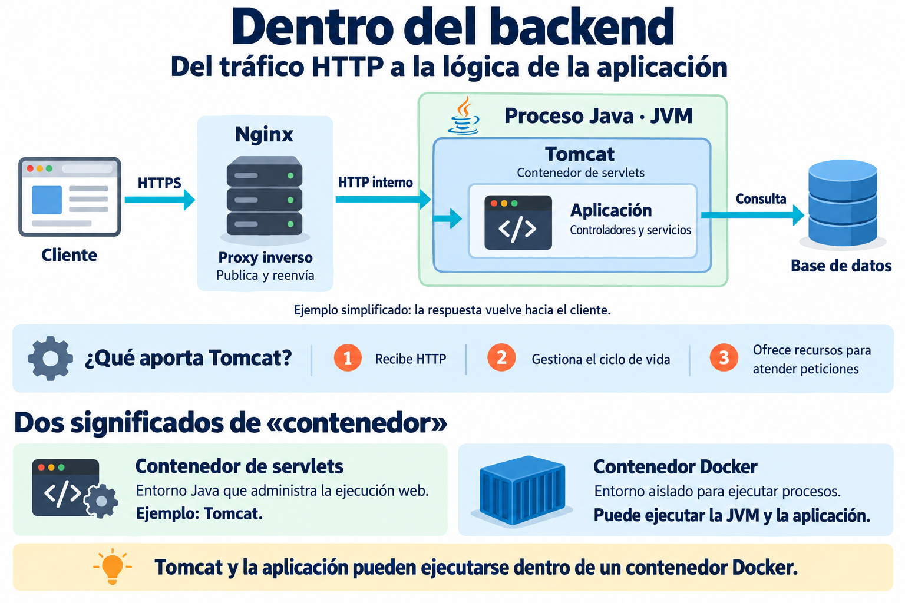
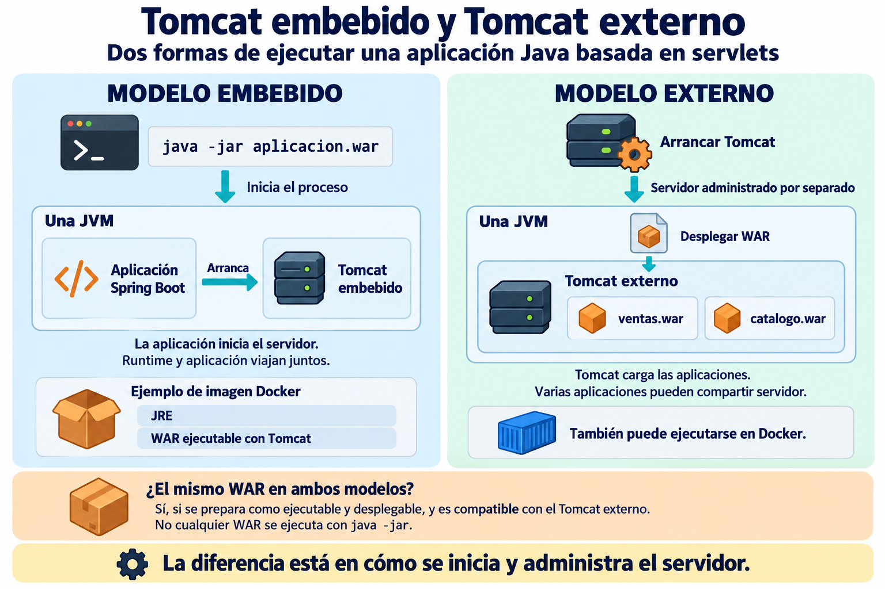
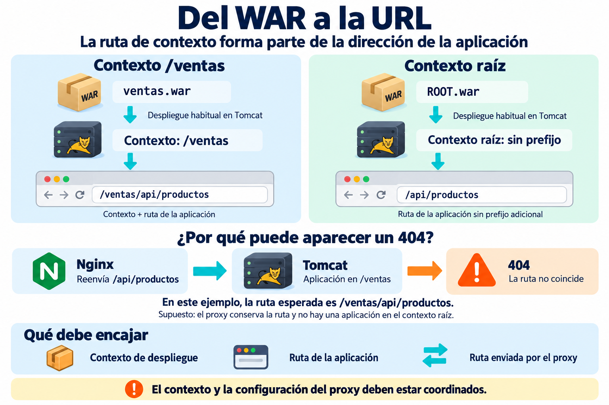
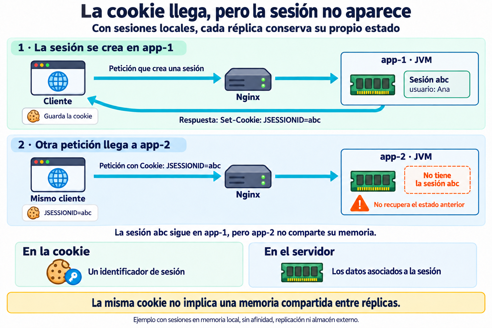
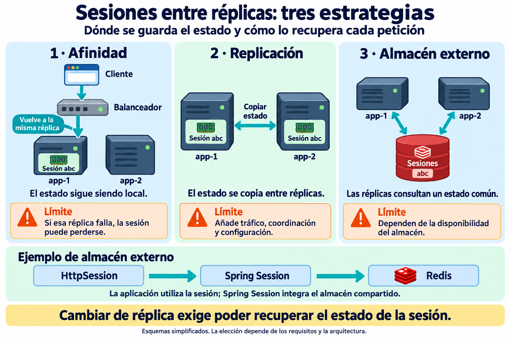
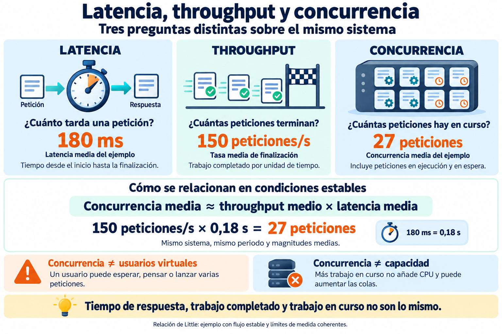
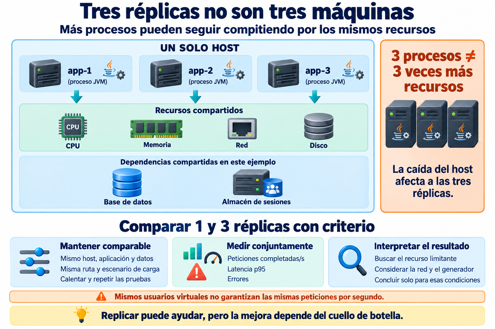

# 🧩 Servidor de aplicaciones: ejecución, estado y rendimiento

!!! info "Descarga de diapositivas"
    [Descarga las diapositivas](diapositivas/servidor-aplicaciones.pdf){target="_blank" rel="noopener"}

---

Hasta ahora hemos observado principalmente la entrada al sistema: publicación web, HTTPS, balanceo y registros de peticiones. En esta sesión abrimos el backend para comprender **cómo se ejecuta la aplicación, dónde conserva su estado y qué limita su rendimiento**.

Nos guiarán tres preguntas:

- ¿Qué aporta el servidor donde se ejecuta la aplicación?
- ¿Dónde vive la sesión de un usuario cuando hay varias réplicas?
- ¿Tener tres copias significa disponer de tres veces más capacidad?

Usaremos ejemplos genéricos. Nginx, Tomcat, Spring Boot y Redis permiten concretar los conceptos, pero las ideas sobre estado y recursos compartidos también se aplican a otras tecnologías.

---

## 1. 🌐 Del servidor web a la aplicación

Un servidor web y un servidor de aplicaciones pueden cooperar en la atención de una petición.

| Pieza | Responsabilidad en el ejemplo | Tecnología de ejemplo |
|---|---|---|
| Servidor web / proxy inverso | Recibir tráfico, servir estáticos, terminar HTTPS y reenviar peticiones | Nginx |
| Entorno de ejecución web | Recibir las peticiones reenviadas y administrar la ejecución web | Tomcat |
| Aplicación | Ejecutar controladores, reglas de negocio y acceso a datos | Aplicación Java con Spring Boot |

Estas funciones no son exclusivas: Tomcat también puede recibir HTTP directamente y servir recursos estáticos. La separación anterior describe una arquitectura habitual con un proxy delante.



*En este ejemplo, Nginx termina HTTPS y utiliza HTTP hacia el backend. Ese tramo también podría protegerse con HTTPS.*

Tomcat es, con más precisión, un **contenedor de servlets**: implementa el entorno necesario para ejecutar componentes web Java. La aplicación y Tomcat pueden estar dentro de la misma JVM; el dibujo no representa un proceso distinto para cada uno.

Otros servidores, como WildFly o Payara, incorporan más servicios de la plataforma Jakarta EE. Basta con reconocer que Tomcat no equivale a un servidor Jakarta EE completo.

---

## 2. ⚙️ Qué aporta un contenedor de servlets

El contenedor administra el contexto web y el ciclo de vida de sus componentes: inicialización, atención de peticiones y retirada de la aplicación. También proporciona mecanismos para gestionar sesiones y recursos de ejecución.

La palabra **contenedor** tiene aquí un significado diferente al de Docker:

- Un **contenedor de servlets** proporciona un entorno de ejecución web Java.
- Un **contenedor Docker** aísla procesos y sus recursos. Puede ejecutar una JVM que contenga Tomcat y la aplicación.

### Peticiones concurrentes y recursos disponibles

El servidor no crea una máquina ni una JVM por petición. En un modelo habitual utiliza un conjunto de hilos para atender trabajo concurrente. Los detalles cambian con la configuración y con los mecanismos de ejecución asíncrona.

Una petición puede estar ejecutándose o esperando: por un hilo, una conexión a la base de datos, una respuesta de otro servicio o cualquier otro recurso. Si se alcanzan los límites, pueden aparecer colas, rechazos o tiempos de espera agotados.

!!! important "Más concurrencia no crea más CPU"
    Aceptar más trabajo simultáneo puede aprovechar tiempos de espera, pero también aumentar la competencia por recursos. El número de peticiones en curso no equivale necesariamente al número de hilos ocupados.

---

## 3. 📦 Un WAR preparado para dos modelos de ejecución

Conviene distinguir tres niveles:

| Elemento | Qué representa |
|---|---|
| **WAR** | Artefacto que empaqueta una aplicación web Java y sus recursos |
| **Imagen de contenedor** | Paquete con el entorno y los ficheros necesarios para ejecutar procesos |
| **Contenedor en ejecución** | Instancia de una imagen con sus procesos y recursos |

Una aplicación Spring Boot basada en servlets puede prepararse como **WAR ejecutable y desplegable**. Esto permite utilizar el mismo artefacto en dos modelos.



### 3.1. Tomcat embebido

La aplicación inicia su servidor web dentro del mismo proceso Java. Para un WAR ejecutable preparado con ese fin:

```bash
java -jar aplicacion.war
```

Una imagen podría incluir el runtime Java y ese artefacto. Normalmente cada aplicación autónoma tiene su propio proceso. También existen aplicaciones Spring Boot empaquetadas como JAR ejecutable: el uso de un servidor embebido no exige utilizar WAR.

### 3.2. Tomcat externo

Se administra una instalación de Tomcat y se despliega en ella el WAR. Un mismo Tomcat puede alojar varias aplicaciones, cada una con su contexto, compartiendo el proceso y parte de los recursos del servidor.

«Externo» significa externo al artefacto de la aplicación; **no significa que tenga que estar en otra máquina ni fuera de Docker**.

### 3.3. Qué debe estar preparado

No cualquier WAR funciona con `java -jar`. Para admitir ambos modelos hacen falta el empaquetado ejecutable, la inicialización para el despliegue externo y una gestión adecuada de las dependencias del servidor. Además, la aplicación, Java y el Tomcat externo deben ser compatibles.

No es necesario implementar esos ajustes en esta explicación; sí comprender que **la doble ejecución es una propiedad del artefacto preparado, no de la extensión `.war` por sí sola**. [Referencia: despliegue tradicional de Spring Boot](https://docs.spring.io/spring-boot/how-to/deployment/traditional-deployment.html).

| Aspecto | Tomcat embebido | Tomcat externo |
|---|---|---|
| Arranque | La aplicación inicia el servidor | Tomcat carga la aplicación |
| Versión del servidor | Se gestiona con las dependencias de la aplicación | Se administra por separado, respetando compatibilidad |
| Actualizar la aplicación | Sustituir artefacto, proceso o imagen | Reemplazar el WAR o la imagen que lo contiene |
| Varias aplicaciones | Habitualmente procesos separados | Pueden compartir servidor |
| Uso con Docker | Posible | Posible |

La elección depende del despliegue y de cómo se quiera administrar cada unidad.

---

## 4. 🗂️ Qué conviene identificar en Tomcat

En una instalación sencilla, con instalación y configuración de instancia reunidas, encontramos una estructura similar a esta:

```text
tomcat/
├── conf/
│   ├── server.xml
│   ├── context.xml
│   └── tomcat-users.xml
├── lib/
└── webapps/
    ├── ROOT/
    └── ventas/
```

| Elemento | Función habitual |
|---|---|
| `conf/server.xml` | Conectores, puertos y estructura principal del servidor |
| `conf/context.xml` | Configuración predeterminada de los contextos |
| `conf/tomcat-users.xml` | Usuarios y roles cuando se utiliza el mecanismo de autenticación correspondiente |
| `lib/` | Bibliotecas compartidas según la configuración de carga de clases |
| `webapps/` | Ubicación habitual de aplicaciones desplegadas, como WAR o directorios |

El árbol es orientativo: pueden separarse los directorios de instalación e instancia y configurarse otras ubicaciones. `tomcat-users.xml` no es necesariamente el registro de usuarios de la aplicación.

Las dependencias compartidas reducen duplicación, pero pueden acoplar aplicaciones: si una necesita una versión de una biblioteca y otra requiere una diferente, habrá que resolver esa compatibilidad. Empaquetar las dependencias propias con cada aplicación facilita gestionarlas de forma independiente.

---

## 5. 🛣️ WAR, contexto y URL publicada

La **ruta de contexto** es el prefijo que identifica una aplicación dentro del servidor. En el despliegue habitual de Tomcat externo, el nombre del WAR permite derivarla:

| Artefacto | Contexto | Ejemplo de ruta en Tomcat |
|---|---|---|
| `ventas.war` | `/ventas` | `/ventas/api/productos` |
| `ROOT.war` | Raíz, sin prefijo | `/api/productos` |

Esta es la convención habitual; existen configuraciones explícitas de despliegue que pueden cambiar la relación entre nombre y contexto. [Referencia: contextos de Tomcat](https://tomcat.apache.org/tomcat-10.1-doc/config/context.html).



Si el proxy reenvía `/api/productos` sin modificarla, pero el endpoint está publicado en `/ventas/api/productos`, la petición no llega a ese endpoint. En el ejemplo, al no haber una aplicación en el contexto raíz, se obtiene un `404`.

Para diagnosticarlo hay que comprobar **la ruta recibida por el proxy, la que envía al backend, el contexto y la ruta definida por la aplicación**. Un 404 no implica necesariamente que Tomcat esté detenido.

Desplegar como `ROOT.war` puede situar una aplicación compatible en el contexto raíz sin modificar su lógica. Aun así, deben revisarse las rutas del proxy y las URL, redirecciones o recursos que puedan asumir un prefijo concreto. Renombrar el WAR no corrige automáticamente todos esos ajustes.

---

## 6. 🧠 Sesiones: dónde vive el estado

HTTP no conserva por sí mismo una conversación entre peticiones. Una **sesión** permite asociar a un cliente datos que se recuperan en peticiones posteriores: por ejemplo, un identificador de usuario o un paso de un proceso.

### 6.1. Identificador en el cliente, datos en el servidor

En una sesión de servidor típica, el navegador conserva una cookie con un identificador. En el ejemplo de Tomcat usamos `JSESSIONID`:

```http
Set-Cookie: JSESSIONID=abc
```

En una petición posterior para la que corresponda enviar esa cookie:

```http
Cookie: JSESSIONID=abc
```

Son cabeceras simplificadas para explicar el mecanismo; el identificador real es opaco y la cookie tiene atributos que condicionan su envío y protección. **En este modelo, la cookie no contiene todos los datos de la sesión.**

### 6.2. Qué ocurre con varias réplicas

Si el estado está en la memoria local de `app-1`, otra réplica no lo conoce automáticamente, aunque reciba el mismo identificador.



Según la aplicación, esto puede provocar una nueva sesión, la pérdida aparente de datos o la necesidad de identificarse de nuevo. No implica siempre el mismo código de respuesta HTTP.

El problema es similar al de un fichero guardado únicamente dentro de una réplica: **poder llegar a cualquier copia no significa que todas tengan acceso al mismo estado**.

Tomcat admite mecanismos de persistencia y administración de sesiones. Conservarlas en disco durante determinados reinicios no equivale a compartirlas entre réplicas ni garantiza recuperarlas ante cualquier fallo. [Referencia: administración de sesiones en Tomcat](https://tomcat.apache.org/tomcat-10.1-doc/config/manager.html).

### 6.3. Tres estrategias



- **Afinidad o sticky session:** dirige al cliente a la misma réplica. Por sí sola no copia la sesión y puede repartir la carga de forma desigual.
- **Replicación:** intercambia estado entre servidores. Requiere configuración y coordinación; sus garantías dependen del mecanismo utilizado.
- **Almacén externo:** permite que varias réplicas consulten un estado común. Añade una dependencia cuya disponibilidad, capacidad y conservación de datos deben administrarse.

### 6.4. Ejemplo: Spring Session y Redis

Spring Session puede integrar `HttpSession` con un repositorio externo como Redis. La aplicación sigue utilizando la abstracción de sesión mientras la integración se encarga del almacenamiento. **Arrancar Redis no basta**: la aplicación necesita las dependencias y la configuración correspondientes. [Referencia: integración de HttpSession](https://docs.spring.io/spring-session/reference/http-session.html).

Todas las réplicas deben utilizar una configuración compatible y acceder al mismo repositorio de sesiones. El nombre de la cookie puede cambiar según la integración; no debe suponerse que siempre seguirá siendo `JSESSIONID`.

Cambiar de réplica permite recuperar el estado **si la sesión sigue siendo válida y el almacén está disponible**. La expiración, el cierre de sesión o un fallo del repositorio siguen teniendo efectos. Externalizar las sesiones tampoco externaliza automáticamente los ficheros, las cachés locales o el resto del estado de la aplicación.

!!! info "Objetivo de aprendizaje"
    Lo importante es reconocer qué estado se conserva, quién puede recuperarlo y qué dependencia aparece al compartirlo. No hace falta aprender la API de Redis ni configurar una solución de alta disponibilidad en esta sesión.

---

## 7. 📈 Rendimiento: tres magnitudes distintas



| Magnitud | Pregunta | Unidad |
|---|---|---|
| **Latencia** | ¿Cuánto tarda una petición en completarse? | Milisegundos o segundos |
| **Throughput** | ¿Cuánto trabajo se completa por unidad de tiempo? | Por ejemplo, peticiones/s |
| **Concurrencia** | ¿Cuántas peticiones permanecen en curso al mismo tiempo? | Número de peticiones |

La concurrencia incluye ejecución y espera dentro del ámbito que medimos. No equivale al número de usuarios registrados, usuarios virtuales o hilos del servidor.

### Una relación útil: la ley de Little

Para un flujo estable, usando medias y límites de medida coherentes:

```text
concurrencia media ≈ throughput medio × latencia media

150 peticiones/s × 0,18 s = 27 peticiones
```

Los 180 ms se convierten en 0,18 s para que las unidades encajen. El resultado significa **27 peticiones en curso de media**, no que haya exactamente 27 en cada instante.

No se sustituye la latencia media por el p95 en esta relación. Tampoco se mezclan, por ejemplo, el throughput de todo un servicio con la latencia de una única ruta. Si la cola crece continuamente, el sistema no está en el régimen estable supuesto en este ejemplo.

La latencia depende de dónde comienza y termina la medida: cliente, proxy y aplicación pueden observar intervalos diferentes. Debemos identificar ese ámbito antes de comparar cifras.

---

## 8. 📊 Throughput, p95 y errores se interpretan juntos

El **p95** resume un umbral de latencia que aproximadamente el 95 % de las observaciones no supera, según el método de cálculo. No es el máximo ni la media de las peticiones más lentas.

Para comparar configuraciones necesitamos observar conjuntamente:

| Métrica | Qué aporta | Qué revisar |
|---|---|---|
| Peticiones/s | Ritmo de trabajo completado | Si incluye respuestas fallidas |
| Latencia p95 | Comportamiento de la parte alta de la distribución | Mismo ámbito, rutas y criterio de selección |
| Errores | Fallos según el criterio de la prueba | Recuento, porcentaje y validación de la respuesta |

Una configuración que responde rápido con errores no ha demostrado una mejora útil. Un aumento del throughput tampoco basta si la latencia deja de ser aceptable.

Mantendremos criterios equivalentes en ambas pruebas y un número suficiente de muestras. Como vimos en observabilidad, **no se obtiene el p95 global promediando los p95 de las réplicas**.

---

## 9. 🖥️ Tres réplicas no son tres máquinas

Consideremos un host que ejecuta tres procesos de aplicación, una base de datos y un almacén de sesiones. Es una configuración ilustrativa: esas dependencias también podrían estar en otros hosts.



Las réplicas pueden aprovechar mejor ciertos recursos o permitir sustituir un proceso mientras otros atienden tráfico. Pero todas siguen compitiendo por los recursos disponibles.

| Pueden facilitar | No garantizan |
|---|---|
| Repartir trabajo entre procesos | Triplicar el throughput |
| Mantener servicio si falla un proceso y se gestiona el fallo | Sobrevivir a la caída del host |
| Reemplazar copias progresivamente | Mantener sesiones sin una estrategia de estado |
| Aprovechar capacidad que una copia no utilizaba | Añadir CPU o memoria física |

La mejora depende del **cuello de botella**. Si el límite está en una consulta o en el disco compartido, añadir procesos puede aumentar la espera. Además, cada réplica consume memoria y puede abrir su propio conjunto de conexiones a la base de datos.

---

## 10. 🧪 Comparar una y tres réplicas con criterio

Una prueba pequeña sirve para observar un comportamiento concreto, no para certificar la capacidad de producción.

### 10.1. Preparar condiciones comparables

Cambiaremos el número de réplicas y mantendremos comparables:

- Host, recursos asignados y configuración de las dependencias.
- Versión de la aplicación, datos y estado inicial relevante.
- Ruta, método, contenido de la petición y comprobaciones de respuesta.
- Herramienta, equipo generador, escenario de carga y duración medida.
- Política de calentamiento y condiciones de red, en la medida de lo posible.

Al calentar permitimos que arranquen conexiones, cachés y otros mecanismos. Debemos aplicar el mismo criterio a ambas configuraciones y separar ese periodo de la medida que queremos comparar. Repetiremos las pruebas y conservaremos sus resultados, sin elegir únicamente la ejecución más favorable.

### 10.2. Usuarios virtuales y tasa de llegada

En un **modelo cerrado**, cada usuario virtual ejecuta una iteración y espera a terminar antes de comenzar la siguiente. Si las respuestas se ralentizan, puede generar menos peticiones por segundo. Por eso **el mismo número de usuarios virtuales no implica la misma tasa de peticiones**.

En un **modelo abierto**, se programa una tasa de inicio de trabajo independiente de la duración de las respuestas. El generador necesita capacidad para sostenerla; deben comprobarse también las iteraciones que no consigue iniciar. Una iteración puede contener varias peticiones.

Para una comparación introductoria basta con mantener el mismo escenario, entender su modelo y registrar la carga realmente conseguida. [Referencia: modelos abiertos y cerrados en k6](https://grafana.com/docs/k6/latest/using-k6/scenarios/concepts/open-vs-closed/).

### 10.3. Medir y explicar

Podemos organizar los resultados con esta tabla, sin presuponer cuál será mejor:

| Configuración | Ejecución | Peticiones/s | p95 (ms) | Errores (%) | Observaciones |
|---|---|---|---|---|---|
| 1 réplica | 1 | — | — | — | — |
| 3 réplicas | 1 | — | — | — | — |

Las observaciones deben incluir lo que ayude a explicar la diferencia: CPU, memoria, esperas, conexiones, base de datos o incidencias de red.

Si utilizamos k6, debemos conocer el significado de cada métrica. Por ejemplo, `http_req_duration` suma envío, espera y recepción, pero no incluye todos los tiempos previos de conexión. No representa automáticamente el mismo intervalo que una medida del proxy. [Referencia: métricas incorporadas de k6](https://grafana.com/docs/k6/latest/using-k6/metrics/reference/).

### 10.4. Qué podemos concluir

Ejecutar el generador en otro equipo evita que compita directamente por la CPU del host medido. Aun así, su propia capacidad y la red entre ambos pueden limitar o alterar el resultado.

Una conclusión válida identifica **configuración, escenario y resultados observados**. Por ejemplo: «En estas condiciones, tres réplicas completaron más peticiones por segundo, con este p95 y este porcentaje de errores».

Eso no demuestra cuántos usuarios reales soportará cualquier despliegue en producción. Las rutas, los datos, las dependencias, el tráfico y los recursos pueden ser diferentes.

---

## 🎯 Qué debes saber hacer al salir de esta sesión

- Diferenciar proxy, entorno de ejecución web y aplicación.
- Explicar qué aporta un contenedor de servlets y distinguirlo de Docker.
- Comparar Tomcat embebido y externo, y reconocer las condiciones para reutilizar un WAR.
- Identificar los principales directorios y ficheros de Tomcat.
- Relacionar artefacto, contexto y ruta enviada por el proxy.
- Distinguir el identificador de sesión del estado conservado en el servidor.
- Explicar el problema del estado local y comparar las tres estrategias de sesiones.
- Describir qué consigue la integración de Spring Session con Redis.
- Diferenciar latencia, throughput y concurrencia, usando correctamente sus unidades.
- Interpretar conjuntamente throughput, p95 y errores.
- Explicar los límites de varias réplicas sobre un mismo host.
- Diseñar e interpretar una comparación pequeña y reproducible.

Basta con **reconocer**, sin administrarlos en profundidad, los servidores Jakarta EE completos, la carga de bibliotecas compartidas, la replicación nativa de sesiones y otros tipos de pruebas de rendimiento.

---

## ✅ Ideas clave

??? tip "Abrir resumen"

    - Tomcat administra la ejecución web; la aplicación implementa la lógica.
    - Un contenedor de servlets puede ejecutarse dentro de un contenedor Docker.
    - Un WAR preparado y compatible puede admitir ejecución autónoma y despliegue externo.
    - Contexto, rutas de aplicación y configuración del proxy deben encajar.
    - La cookie de sesión identifica un estado; no lo comparte entre réplicas.
    - Afinidad, replicación y almacén externo resuelven el acceso al estado de maneras distintas.
    - Externalizar sesiones introduce una dependencia que también hay que administrar.
    - La relación entre concurrencia, throughput y latencia utiliza medias y un ámbito coherente.
    - Throughput, p95 y errores deben interpretarse juntos.
    - Tres procesos en un host no añaden tres veces más recursos.
    - Una prueba permite concluir únicamente dentro de sus condiciones.

---

Con esta sesión cerramos el tema: publicar y observar una aplicación también exige comprender cómo se ejecuta, qué estado necesita y qué recursos limitan su funcionamiento.
