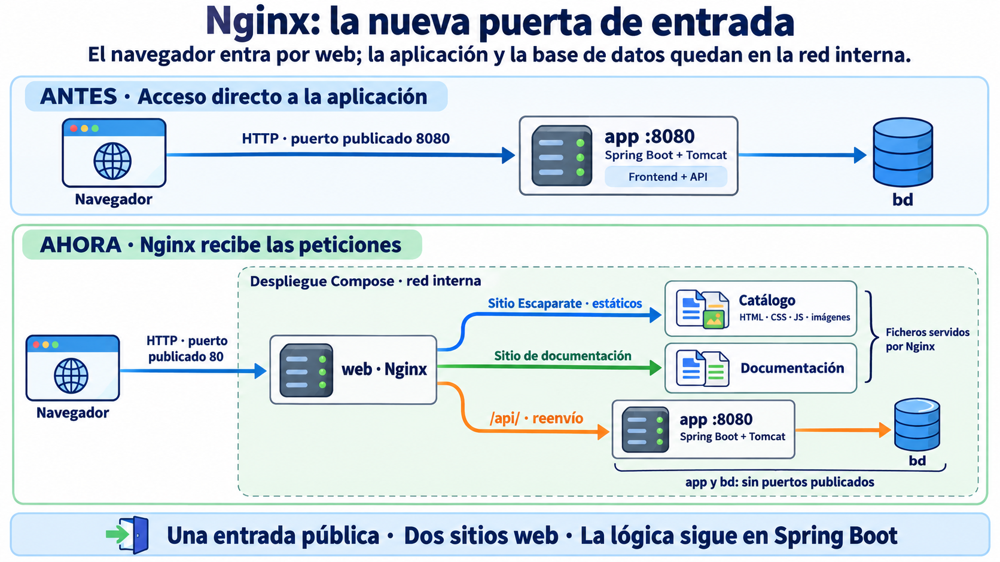
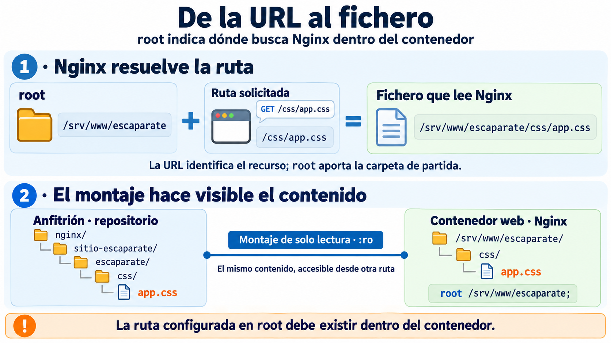
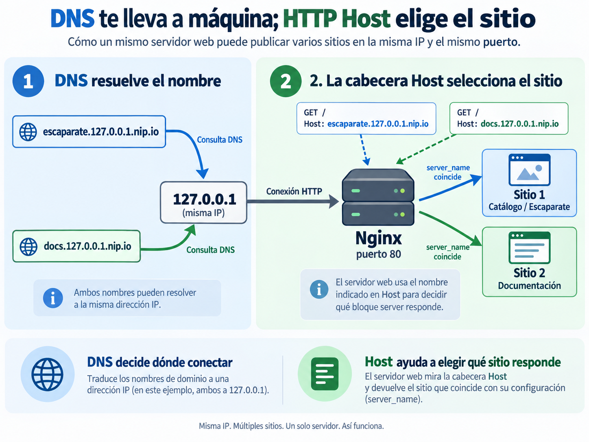

# 🌐 Servidores web y DNS

!!! info "Descarga de diapositivas"
    [Descarga las diapositivas](diapositivas/servidores-web-dns.pdf){target="_blank" rel="noopener"}

---

En el Tema 2 conseguiste levantar Escaparate como un conjunto reproducible formado por `app` y `bd`. Hasta ahora, el navegador accedía directamente a Spring Boot mediante el puerto publicado de la aplicación.

En este tema aparece una nueva capa: **Nginx se convierte en la puerta de entrada HTTP**. Servirá directamente los recursos estáticos y permitirá que la aplicación Java quede detrás, dentro de la red del despliegue.

!!! abstract "Mapa de la sesión"
    **Separar → publicar → nombrar → diagnosticar → optimizar**

    Hoy estudiaremos la entrega de contenido estático, los hosts virtuales, la relación entre DNS y HTTP y algunas políticas que un servidor web puede aplicar a los recursos que sirve.

---

## 🗂️ 1. Qué aporta un servidor web

Un **servidor web** escucha peticiones HTTP y devuelve respuestas HTTP. Cuando sirve contenido estático, relaciona una URL con un fichero y lo entrega con las cabeceras apropiadas.

La **raíz de documentos** marca desde dónde se buscan los recursos públicos. En el apartado 2.1 veremos cómo se combina con la ruta solicitada y con los montajes del contenedor. Dentro de ella no deben aparecer accidentalmente secretos, copias de seguridad, scripts SQL o ficheros internos.

### 1.1. Estático y dinámico

En este despliegue, Nginx **lee y entrega los ficheros estáticos** del frontend: HTML, CSS, JavaScript e imágenes. Las peticiones a `/api/...` se reenvían a Spring Boot, que **ejecuta la lógica y genera la respuesta**. La figura del apartado 2 muestra ambos recorridos.

El reenvío dinámico aparecerá hoy únicamente como conexión con el backend. En la siguiente sesión estudiarás el **proxy inverso** con detalle.

### 1.2. Apache y Nginx

Apache HTTP Server y Nginx son servidores web maduros capaces de servir estáticos y actuar como proxy. No existe una regla general que convierta a uno en «mejor» que al otro.

En este módulo utilizaremos **Nginx** porque la misma herramienta nos permitirá estudiar progresivamente:

- contenido estático y hosts virtuales;
- proxy inverso y balanceo;
- HTTPS y control de acceso;
- logs y observabilidad.

??? info "Diferencias habituales"
    | | Apache | Nginx |
    |---|---|---|
    | Procesamiento | configurable mediante distintos MPM | arquitectura orientada a eventos |
    | Configuración | central y, si se habilita, por directorio con `.htaccess` | central |
    | Ecosistema | muy amplio | ampliamente utilizado como servidor web y proxy |
    | Uso frecuente | hosting y servidor web general | estáticos, proxy y punto de entrada |

---

## 🧱 2. Nginx como nueva puerta de entrada

Nginx no sustituye a Escaparate. La aplicación sigue ejecutándose mediante **Spring Boot + Tomcat embebido**. Lo que cambia es qué pieza recibe primero las conexiones públicas.



*Figura 1. Evolución del despliegue: Nginx recibe las conexiones públicas y sirve dos sitios; Spring Boot conserva la lógica de aplicación.*

`app` deja de publicar su puerto 8080 al anfitrión y `bd` permanece sin publicar. **La única entrada pública será el puerto 80 de `web`**; la comunicación con la aplicación y la base de datos continúa dentro de la red del despliegue.

### 2.1. Servicio, configuración y contenido

En Compose añadiremos un servicio similar a:

```yaml
services:
  web:
    image: nginx:1.30.4-alpine
    ports:
      - "80:80"
    volumes:
      - ../nginx/conf.d:/etc/nginx/conf.d:ro
      - ../nginx/sitio-escaparate/escaparate:/srv/www/escaparate:ro
      - ../nginx/sitio-docs:/srv/www/docs:ro
```

La idea es separar tres cosas:

| Elemento | De dónde procede |
|---|---|
| **Nginx** | imagen oficial |
| **Configuración** | fichero versionado montado desde el repositorio |
| **Contenido estático** | directorios versionados montados en modo de solo lectura |

La imagen oficial utiliza `/usr/share/nginx/html` como ubicación web predeterminada, pero no estamos obligados a usarla. Cada bloque `server` puede declarar su propia raíz mediante `root`.

!!! info "Dos copias del frontend durante esta transición"
    La imagen de `app` todavía contiene el frontend integrado de sesiones anteriores. No desaparece físicamente, pero el navegador deja de utilizar esa copia: desde ahora Nginx sirve la distribución estática montada en `web`.

La siguiente figura conecta la URL con las rutas del repositorio y del contenedor. Con `root /srv/www/escaparate`, solicitar `/css/app.css` conduce al fichero `/srv/www/escaparate/css/app.css`.



*Figura 2. Relación entre la ruta solicitada, la raíz de documentos y el montaje del contenido.*

El montaje permite ver el mismo contenido desde otra ruta; **no es una copia al contenedor**. El sufijo `:ro` impide modificar ese contenido desde el montaje. Tanto `root` como las comprobaciones de rutas deben referirse a su ubicación **dentro de `web`**.

### 2.2. Validar antes de recargar

La configuración de Nginx forma parte de la infraestructura. Antes de aplicarla conviene comprobar su sintaxis:

```bash
docker compose exec web nginx -t
```

Si es correcta, puedes recargarla sin recrear el contenedor:

```bash
docker compose exec web nginx -s reload
```

La rutina es:

```text
editar
  ↓
validar
  ↓
recargar
  ↓
comprobar
```

!!! tip "Primero valida"
    Reiniciar el contenedor después de cada cambio puede funcionar, pero oculta una capacidad útil del servidor: **recargar una configuración válida sin sustituir el contenedor**.

---

## 🏠 3. De un nombre al sitio correcto

Dos sitios pueden compartir **la misma dirección IP y el mismo puerto**: DNS permite obtener la dirección a la que conectar y la cabecera HTTP `Host` ayuda a Nginx a seleccionar el sitio solicitado.



*Figura 3. Resolución DNS y selección del sitio mediante la cabecera HTTP `Host`. Elaboración propia.*

### 3.1. DNS resuelve el nombre

Cuando escribes:

```text
http://docs.127.0.0.1.nip.io/
```

el sistema necesita obtener primero una dirección IP.

Un registro `A` relaciona un nombre con una IPv4:

| Registro | Contiene | Ejemplo de uso |
|---|---|---|
| `A` | dirección IPv4 | nombre que apunta directamente a una máquina |
| `CNAME` | otro nombre | alias de otro nombre DNS |

En esta sesión configurarás únicamente el comportamiento asociado a registros `A`; de `CNAME` basta con reconocer su función.

El **TTL** indica durante cuánto tiempo puede mantenerse una respuesta DNS en caché antes de consultarla de nuevo.

Puedes observar una respuesta con:

```bash
dig web.127.0.0.1.nip.io
dig +short web.127.0.0.1.nip.io
```

Para el laboratorio utilizaremos `nip.io`, que devuelve la dirección IP incluida dentro del propio nombre. Así:

```text
escaparate.127.0.0.1.nip.io
docs.127.0.0.1.nip.io
```

pueden resolver ambos a:

```text
127.0.0.1
```

sin registrar un dominio propio.

!!! info "`/etc/hosts` y DNS no son la misma fuente"
    El navegador utiliza el resolutor del sistema, que puede consultar `/etc/hosts`. `dig`, en cambio, realiza una consulta DNS y no utiliza ese fichero para resolver el nombre solicitado.

    Por eso un nombre puede funcionar en el navegador mediante `/etc/hosts` y no existir en DNS.

### 3.2. `Host` selecciona el sitio

Después de resolver el nombre, la petición HTTP conserva el nombre solicitado:

```http
GET / HTTP/1.1
Host: docs.127.0.0.1.nip.io
```

Nginx puede seleccionar un bloque `server` mediante `server_name`:

```nginx
server {
    listen 80;
    server_name docs.127.0.0.1.nip.io;

    root /srv/www/docs;
    index index.html;

    location /informes/ {
        autoindex on;
    }
}
```

Las directivas principales son:

| Directiva | Función |
|---|---|
| `listen` | puerto en el que atiende el bloque |
| `server_name` | nombre o nombres que seleccionan el sitio |
| `root` | raíz de documentos |
| `index` | fichero utilizado al solicitar un directorio |
| `location` | reglas para determinadas rutas |
| `autoindex on` | permite listar un directorio sin índice |

Cada sitio tendrá su bloque `server`, con el nombre y la raíz correspondientes. Así, el catálogo y la documentación comparten Nginx y el puerto 80, pero sirven contenido de directorios distintos.

!!! tip "La frase que debes recordar"
    **DNS decide dónde conectar; `Host` ayuda a elegir qué sitio responde.**

### 3.3. Nombres desconocidos

Si ningún `server_name` coincide, Nginx utiliza un servidor por defecto. Es mejor declarar explícitamente qué debe ocurrir:

```nginx
server {
    listen 80 default_server;
    server_name _;
    return 404;
}
```

De esta forma, un nombre no reconocido no termina mostrando accidentalmente otro sitio configurado.

---

## 🧾 4. Diagnóstico al servir contenido estático

Un síntoma orienta la primera comprobación, pero puede tener varias causas. Revisa una cosa cada vez y utiliza la respuesta HTTP y los logs para contrastar lo que ocurre.


*Figura 4. Primeras comprobaciones ante fallos habituales al servir contenido estático.*

### 4.1. Raíz, índice y permisos

Al solicitar un directorio, intervienen el índice configurado y la posibilidad de listar su contenido. Activa `autoindex` solo en las rutas donde quieras permitir ese listado.

Nginx necesita además:

- permiso de lectura sobre los ficheros;
- permiso para atravesar los directorios;
- una ruta `root` que coincida con la ubicación real dentro del contenedor.

### 4.2. Tipos MIME

El navegador interpreta cada recurso a partir de `Content-Type`.

Ejemplos:

```text
text/html
text/css
application/javascript
image/png
```

Un fichero puede existir y descargarse, pero no funcionar correctamente en el navegador si el servidor lo entrega con un tipo inesperado.

!!! tip "Diagnóstico corto"
    Antes de editar configuración al azar, comprueba **estado → logs → ruta → cabeceras**.

---

## 🗜️ 5. Entregar mejor los recursos estáticos

Separar la entrega de ficheros de la lógica de aplicación permite aplicar políticas específicas a los recursos estáticos sin modificar Escaparate.

### 5.1. Compresión gzip

HTML, CSS, JavaScript o JSON suelen comprimirse bien.

Nginx puede comprimir la respuesta durante la entrega:

```nginx
gzip on;
gzip_vary on;
gzip_types text/css application/javascript application/json;
```


*Figura 5. Compresión de la respuesta durante la transferencia y descompresión automática en el navegador.*

Cuando se utiliza gzip, `Content-Encoding: gzip` identifica la compresión de la respuesta. Con `gzip_vary on`, `Vary: Accept-Encoding` indica que la representación puede variar según lo que admita el cliente.

`text/html` ya está contemplado por el módulo gzip aunque no aparezca en `gzip_types`. El ahorro depende del contenido: los formatos que ya están comprimidos, como JPEG o PNG, suelen beneficiarse poco.

Para comprobar cabeceras:

```bash
curl -I -H "Accept-Encoding: gzip" \
  http://escaparate.127.0.0.1.nip.io/css/app.css
```

Para comparar bytes reales hay que realizar una petición completa:

```bash
curl -s -H "Accept-Encoding: identity" -o /dev/null \
  -w "sin comprimir: %{size_download} bytes\n" \
  http://escaparate.127.0.0.1.nip.io/css/app.css

curl -s -H "Accept-Encoding: gzip" -o /dev/null \
  -w "comprimido:   %{size_download} bytes\n" \
  http://escaparate.127.0.0.1.nip.io/css/app.css
```

### 5.2. Caché del navegador

La cabecera `Cache-Control` permite indicar durante cuánto tiempo puede reutilizarse una respuesta.

No todos los recursos cambian con la misma frecuencia:

| Recurso | Política habitual |
|---|---|
| HTML | caché corta o revalidación |
| CSS, JS e imágenes versionadas | caché más larga |
| respuesta de API | depende del significado y volatilidad del dato |

Para ciertos recursos estáticos podemos utilizar:

```nginx
location ~* \.(css|js|png|jpg|jpeg|svg|webp)$ {
    expires 7d;
}
```


*Figura 6. Reutilización de recursos en caché y publicación de una nueva versión.*

Para publicar una nueva versión con caché larga, cambia el nombre del recurso —por ejemplo, de `app.css` a `app.v2.css`— y **actualiza también la referencia en el HTML**. También puede incorporarse una huella del contenido al nombre. El HTML necesita una política que permita descubrir esos cambios: caché corta o revalidación.

Si mantienes la misma URL, el navegador puede seguir usando la copia anterior mientras la política permita reutilizarla. Que la copia deje de estar vigente no provoca por sí solo una descarga: la comprobación o petición se realiza cuando vuelva a necesitarse el recurso.

### 5.3. Estático y dinámico no significan «cacheable» y «no cacheable»

La política depende de **cuánto cambia la respuesta y cuándo necesita el usuario ver esos cambios**. La tabla del apartado anterior es una orientación; el origen estático o dinámico no determina por sí solo si una respuesta puede almacenarse.

!!! warning "Dinámico no significa nunca cacheable"
    Una API también puede utilizar caché. Lo importante es **no aplicar automáticamente a todas sus respuestas la misma política que a un CSS o una imagen versionada**.

---

## 🎯 Qué debes saber hacer al salir de esta sesión

Al terminar deberías poder:

- explicar la diferencia entre servir un fichero y ejecutar lógica de aplicación;
- incorporar Nginx como única puerta de entrada pública;
- configurar raíces de documentos y varios hosts virtuales;
- validar y recargar Nginx de forma controlada;
- explicar la secuencia **DNS → dirección → `Host` → sitio**;
- declarar un servidor por defecto para nombres desconocidos;
- interpretar síntomas básicos relacionados con `404`, `403`, rutas y tipos MIME;
- activar y comprobar gzip sobre contenido textual;
- aplicar una política de caché a recursos estáticos y justificar por qué no debe trasladarse automáticamente a cualquier respuesta dinámica;
- utilizar `dig` para reconocer una respuesta `A` y su TTL.

---

## ✅ Ideas clave

??? tip "Abrir resumen"

    - Nginx puede actuar como **puerta de entrada HTTP** y servir directamente contenido estático.
    - Spring Boot continúa ejecutando la lógica dinámica mediante su Tomcat embebido.
    - Solo Nginx necesita publicar puerto; `app` y `bd` pueden permanecer en la red interna.
    - `root`, `index` y los montajes determinan qué ficheros puede servir cada sitio.
    - La configuración se valida con `nginx -t` antes de recargarla.
    - **DNS lleva el nombre a una dirección; `Host` permite seleccionar el sitio**.
    - Un `default_server` explícito evita responder con el sitio equivocado ante nombres desconocidos.
    - Gzip reduce bytes transferidos en contenido textual sin modificar el fichero original.
    - La caché debe adaptarse a la volatilidad de cada recurso.
    - `/etc/hosts` puede afectar al resolutor del sistema, mientras `dig` consulta DNS directamente.

---

En la actividad añadirás Nginx al despliegue de Escaparate, publicarás dos sitios sobre el mismo puerto y comprobarás cómo cooperan **DNS, HTTP y el servidor web**. El bloque `/api/` funcionará todavía como una caja negra; en la siguiente sesión estudiarás el proxy inverso.
